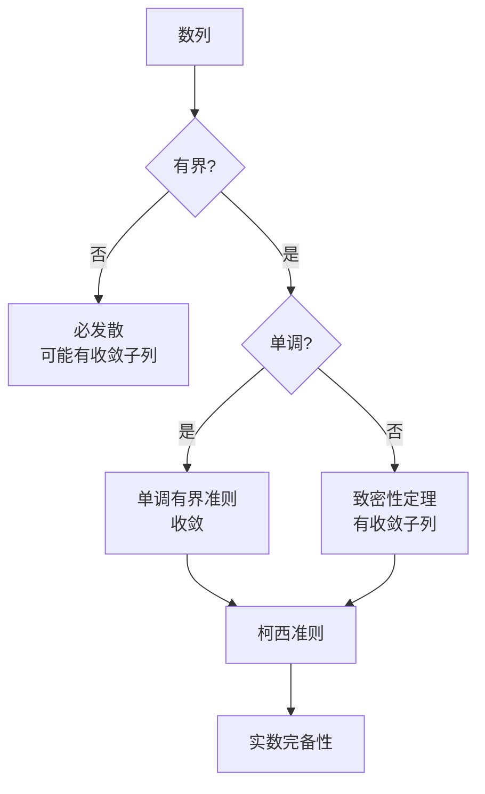

# 第 2 章：数列极限

- **难度**：★★☆ | **预估学时**：3 小时 | **前置**：第 1 章（确界原理、绝对值不等式）

## 学习目标

学完本章，你能：

1. 用 $\varepsilon$-$N$ 语言写出 $\lim_{n\to\infty}a_n=a$，并对给定数列验证它。
2. 用单调有界准则证明递推数列收敛，并求出极限。
3. 分清"收敛"与"柯西列"，说明为什么在实数里两者等价。

## 一句话核心

数列极限不是"越来越接近"这种模糊说法，而是一场对抗：你给任意小的 $\varepsilon$，我必须在某一项之后把整条尾巴都关进 $a$ 的 $\varepsilon$ 邻域。

## 零基础讲解

### 概念 1：从"越来越近"到 $\varepsilon$-$N$（难度：高难）

先看一个具体数列：$a_n=1+\frac1n$。直观上它趋向 1。但"趋向"不能拿来做证明，因为"接近"没有门槛。

分析里的做法是把门槛交给对方：你说一个 $\varepsilon=0.01$，我找一个 $N$，使得从第 $N$ 项起，后面每一项与 1 的差都小于 0.01。这里 $|a_n-1|=1/n$，取 $N=100$ 就够。

定义：设 $\{a_n\}$ 是数列，$a$ 是实数。若对任意 $\varepsilon&gt;0$，存在正整数 $N$，使得当 $n&gt;N$ 时都有

$$|a_n-a|&lt;\varepsilon,$$

则称数列**收敛**于 $a$，记 $\lim_{n\to\infty}a_n=a$。

读法要点：$\varepsilon$ 是对方给的，$N$ 是我给的，$N$ 可以依赖 $\varepsilon$。顺序不能反——先有 $\varepsilon$ 才有 $N$。把"存在 $N$ 对任意 $\varepsilon$"写出来，意思就变成"有一个 $N$ 能管住所有 $\varepsilon$"，这是错的。

不收敛的数列叫**发散**。发散有两种：跑到无穷（如 $a_n=n$），或者来回震荡不落点（如 $a_n=(-1)^n$）。

### 概念 2：收敛数列的五条性质（难度：基础）

1. **唯一性**：极限若存在则唯一。证明用反证：设两个极限 $a&lt;b$，取 $\varepsilon=(b-a)/2$，两条尾巴分别落在 $a$ 和 $b$ 的邻域里，而这两个邻域不相交，矛盾。
2. **有界性**：收敛数列必有界。取 $\varepsilon=1$，$N$ 之后的所有项都被 $|a|+1$ 罩住，前面的有限项取最大值即可。
3. **保号性**：若 $\lim a_n=a&gt;0$，则从某项起 $a_n&gt;0$。因为尾巴落在 $(a/2,\,3a/2)$ 里。
4. **保不等式**：若从某项起 $a_n\le b_n$，且两者都收敛，则 $\lim a_n\le\lim b_n$。注意结论是"小于等于"，即使每项都严格小于，极限也可能相等（$1/n$ 与 $2/n$ 都趋于 0）。
5. **四则运算**：收敛数列的和、差、积、商（分母极限不为 0）仍收敛，极限等于极限的和、差、积、商。证明靠三角不等式拆项：$|a_nb_n-ab|$ 要拆成 $|b_n||a_n-a|+|a||b_n-b|$，再用"收敛必有界"把 $|b_n|$ 控制住。

### 概念 3：两个存在准则（难度：进阶）

**单调有界准则**：单调递增且有上界的数列必收敛；单调递减且有下界的数列必收敛。

证明思路依赖确界原理：取上确界 $\eta=\sup\{a_n\}$，则对任意 $\varepsilon&gt;0$ 存在某一项 $a_N&gt;\eta-\varepsilon$。数列递增，所以 $n&gt;N$ 时 $a_n\ge a_N&gt;\eta-\varepsilon$，同时 $a_n\le\eta$，于是 $|a_n-\eta|&lt;\varepsilon$。

这条准则的实用价值在于"先证存在，再求值"。例如 $a_1=\sqrt2$，$a_{n+1}=\sqrt{2+a_n}$：先证有界（归纳法证 $a_n&lt;2$），再证单调（$a_{n+1}^2-a_n^2=2+a_n-a_n^2=-(a_n-2)(a_n+1)&gt;0$），于是极限存在；设极限为 $A$，两边取极限得 $A=\sqrt{2+A}$，解得 $A=2$。

**柯西准则**：数列 $\{a_n\}$ 收敛的充要条件是对任意 $\varepsilon&gt;0$，存在 $N$，当 $m,n&gt;N$ 时 $|a_n-a_m|&lt;\varepsilon$。

柯西列说的是"自己人之间越来越挤"，不提极限是谁。在实数里，"自己人挤成一团"必然挤到某个实数上，这就是完备性。在有理数范围内这句话不成立：把 $\sqrt2$ 的不足近似值排成数列，它是柯西列，但在有理数里没有极限。

**致密性定理**：有界数列必有收敛子列。证明用二分法不断缩小包含无穷多项的区间，区间套定出一个点，再在该点附近取子列。

### 概念 4：两个常用极限与无穷大量（难度：基础）

$$\lim_{n\to\infty}\left(1+\frac1n\right)^n=e,\qquad \lim_{n\to\infty}\sqrt[n]{n}=1.$$

第一条用二项式展开证明数列单调递增且有上界（上界 3 就够），再用单调有界准则。第二条取对数后用"$n&gt;1$ 时 $n=(1+h_n)^n$"展开，证明 $h_n\to0$。

**无穷大量**：对任意 $M&gt;0$，存在 $N$，当 $n&gt;N$ 时 $|a_n|&gt;M$，记 $\lim a_n=\infty$。它不是一个数，是一种发散方式。无穷大量与无穷小量互为倒数关系（在符号意义下）。

## 图示

看图说明：从"有界"分叉的两条路，最后都汇到柯西准则，再指回实数完备性。这张图的用处是判断该用哪个工具：单调的用准则，不单调但有界的用子列，什么都不知道的先查柯西。

## 类比与实例

- 类比：$\varepsilon$-$N$ 像考试分数线。老师说"及格线由你定"（$\varepsilon$ 任意），学生必须找到"从第几名开始全班都在线上"（$N$）。找不出 $N$，就是没收敛。失效边界：这里比的是"离目标的距离"，不是"分数高低"。
- 实例：证明 $\lim_{n\to\infty}\frac{3n+1}{2n-1}=\frac32$。计算 $|a_n-\frac32|=\frac{5}{2(2n-1)}$。要对任意 $\varepsilon&gt;0$ 让它小于 $\varepsilon$，解出 $n&gt;\frac12(\frac{5}{2\varepsilon}+1)$，取 $N$ 为该数的整数部分即可。整个证明只有"算距离、解不等式、取整"三步，不需要任何技巧。

## 常见误解

- 别以为"$\varepsilon$ 越小 $N$ 越大，所以极限依赖 $\varepsilon$"——实际上极限是定值，只有 $N$ 随 $\varepsilon$ 变。
- 别以为"去掉有限项会改变敛散性"——实际上极限只看尾巴，前一万项随便改都不影响。
- 别以为"柯西列就是收敛列"——在实数里是，在有理数里不是；这句话的成立依赖于完备性。
- 别以为"无界一定发散到无穷"——实际上 $a_n=n\sin n$ 无界，但不趋于 $+\infty$，它只是乱跑。

## 自测题（答案）

1. 单选：若 $\lim a_n=a$，下列哪条一定成立？（ ）
   - A. $a_n$ 单调　B. $a_n$ 有界　C. $a_n$ 从某项起等于 $a$　D. $a_n$ 有上界但无下界

   **答案**：B。解析：收敛必有界；单调不是必要条件；等于 $a$ 更不可能，除非数列最终恒定。

2. 填空：$\lim_{n\to\infty}\left(1+\frac1n\right)^n$ 的值是（ ）。

   **答案**：$e$。解析：这是 $e$ 的数列定义，用单调有界准则可证存在，值为 2.71828…。

3. 简答：数列 $a_n=(-1)^n$ 是柯西列吗？

   **答案**：不是。取 $\varepsilon=1$，任意 $N$，取 $m=N+1$、$n=N+2$，则 $|a_n-a_m|=2&gt;1$，违反柯西条件。它也不收敛。

## 复习锚点

- $\varepsilon$-$N$ 定义的量词顺序：$\forall\varepsilon\exists N\forall n&gt;N$。
- 单调有界准则的证明靠上确界，这是第 1 章确界原理第一次真正派上用场。
- 柯西准则在实数里等价于收敛，在有理数里不等价。
