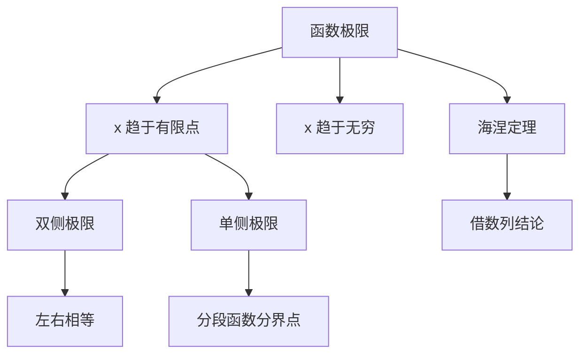

# 第 3 章：函数极限

- **难度**：★★☆ | **预估学时**：3 小时 | **前置**：第 1 章邻域、第 2 章 ε-N

## 学习目标

学完本章，你能：

1. 写出 $\lim_{x\to x_0}f(x)=A$ 的 $\varepsilon$-$\delta$ 定义，并对给定函数验证。
2. 用海涅定理把函数极限换成数列极限，从而借用数列的结论。
3. 区分单侧极限、无穷小阶的比较，并求出曲线的渐近线。

## 一句话核心

函数极限与数列极限是同一件事的两种写法，区别只在于"自变量怎么靠近"：数列只能一个接一个跳，函数可以从两边连续逼近。

## 零基础讲解

### 概念 1：ε-δ 定义（难度：高难）

设 $f$ 在点 $x_0$ 的某个去心邻域内有定义。若对任意 $\varepsilon&gt;0$，存在 $\delta&gt;0$，使得当 $0&lt;|x-x_0|&lt;\delta$ 时都有

$$|f(x)-A|&lt;\varepsilon,$$

则称 $x\to x_0$ 时 $f$ 的极限是 $A$，记 $\lim_{x\to x_0}f(x)=A$。

三个细节必须注意：

- $0&lt;$ 表示 $x\ne x_0$。函数在 $x_0$ 点取什么值、有没有定义，与极限无关。
- $\delta$ 依赖 $\varepsilon$，通常取 $\min\{1,\ \varepsilon/C\}$ 这种形式，先限制在一个小区间里把高阶项压住。
- 结论只要求"$x_0$ 附近"，不要求全局。

例：证明 $\lim_{x\to2}(3x-1)=5$。算距离 $|3x-1-5|=3|x-2|$。要对任意 $\varepsilon$ 让它小于 $\varepsilon$，取 $\delta=\varepsilon/3$ 即可。这是最简单的一类，因为函数是线性的。

稍难：证明 $\lim_{x\to1}\frac{x^2-1}{x-1}=2$。注意函数在 $x=1$ 无定义，但极限照样算。化简 $\frac{x^2-1}{x-1}=x+1$（$x\ne1$），于是 $|f(x)-2|=|x-1|$，取 $\delta=\varepsilon$。

### 概念 2：x 趋于无穷与单侧极限（难度：基础）

$x\to\infty$ 的定义换成"任给 $\varepsilon&gt;0$，存在 $X&gt;0$，当 $|x|&gt;X$ 时 $|f(x)-A|&lt;\varepsilon$"。把 $\delta$ 换成 $X$，其余结构不动。

单侧极限：$x\to x_0^+$ 要求 $x_0&lt;x&lt;x_0+\delta$，$x\to x_0^-$ 要求 $x_0-\delta&lt;x&lt;x_0$。

一条实用结论：$\lim_{x\to x_0}f(x)=A$ 当且仅当左右极限都存在且都等于 $A$。判断分段函数在分界点的极限，就查这一条。

符号函数 $\mathrm{sgn}\,x$ 在 0 点的左右极限分别是 $-1$ 和 $1$，所以极限不存在。

### 概念 3：海涅定理（归结原则）（难度：进阶）

$\lim_{x\to x_0}f(x)=A$ 的充要条件是：对任意满足 $x_n\to x_0$、$x_n\ne x_0$ 的数列，都有 $f(x_n)\to A$。

这条定理的用处是"借力"：想证明某函数极限不存在，只需找两条趋近方式给出不同结果。例如 $\lim_{x\to0}\sin\frac1x$ 不存在，取 $x_n=\frac{1}{2n\pi}$ 得 $\sin=0$，取 $x_n=\frac{1}{2n\pi+\pi/2}$ 得 $\sin=1$，两条子列极限不同。

反过来，想证明极限存在，也可以对任意数列验证，但通常直接走 $\varepsilon$-$\delta$ 更快。

### 概念 4：五条性质与两个重要极限（难度：基础）

性质与数列版对应：唯一性、局部有界性、局部保号性、保不等式性、四则运算。注意"局部"两个字：只在 $x_0$ 的某个邻域内成立，不是全局。

两个重要极限：

$$\lim_{x\to0}\frac{\sin x}{x}=1,\qquad \lim_{x\to0}(1+x)^{1/x}=e.$$

第一条的证明用单位圆面积夹逼：$0&lt;|x|&lt;\pi/2$ 时 $\sin x&lt;x&lt;\tan x$，同除 $\sin x$ 得 $1&lt;\frac{x}{\sin x}&lt;\frac{1}{\cos x}$，两端趋于 1。

第二条把数列版 $\left(1+\frac1n\right)^n\to e$ 推广到实数，用海涅定理与夹逼完成。

### 概念 5：无穷小与无穷大（难度：基础）

趋于 0 的量叫**无穷小**，趋于无穷的叫**无穷大**。两者互为倒数（在符号意义下）。

**阶的比较**：设 $\alpha,\beta$ 都是无穷小。

- $\lim\frac{\alpha}{\beta}=0$：$\alpha$ 是 $\beta$ 的高阶无穷小，记 $\alpha=o(\beta)$。
- $\lim\frac{\alpha}{\beta}=c\ne0$：同阶。
- $\lim\frac{\alpha}{\beta}=1$：等价无穷小，记 $\alpha\sim\beta$。
- $\lim\frac{\alpha}{\beta^k}=c\ne0$：$\alpha$ 是 $\beta$ 的 $k$ 阶无穷小。

常用等价：$x\to0$ 时 $\sin x\sim x$，$\tan x\sim x$，$1-\cos x\sim\frac{x^2}{2}$，$\ln(1+x)\sim x$，$e^x-1\sim x$。

等价替换只能用在乘除，不能直接用在加减。$\sin x-x$ 若把 $\sin x$ 换成 $x$ 得 0，实际它是三阶无穷小，等于 $-\frac{x^3}{6}$ 加高阶项。这是极限计算最常见的错误来源。

**渐近线**：若 $\lim_{x\to\infty}\frac{f(x)}{x}=k$ 且 $\lim_{x\to\infty}(f(x)-kx)=b$，则 $y=kx+b$ 是斜渐近线。竖直渐近线出现在函数趋于无穷的点。

## 图示

看图说明：左侧是"极限往哪里趋"，右侧是"怎么把函数问题转成数列问题"。分段函数题走 E→G 那条；证明不存在走 H→I。

## 类比与实例

- 类比：$\varepsilon$-$\delta$ 像射击训练。$\varepsilon$ 是靶心允许的偏差圈，$\delta$ 是你必须站进的站位区。站位区越小，说明枪法越稳。失效边界：这里不要求打中靶心，只要求所有子弹落在圈内。
- 实例：求 $\lim_{x\to0}\frac{1-\cos x}{x^2}$。用 $1-\cos x=2\sin^2\frac x2$，原式 $=\frac{2\sin^2(x/2)}{x^2}=\frac12\left(\frac{\sin(x/2)}{x/2}\right)^2\to\frac12$。也可以直接用等价替换 $1-\cos x\sim\frac{x^2}{2}$，结果一致。

## 常见误解

- 别以为"极限存在就要求函数在这一点有定义"——实际上定义里写的是去心邻域，函数在该点可以没有定义。
- 别以为"$x\to x_0$ 只看右边"——实际上要左右都算，除非题目明确写单侧。
- 别以为"等价无穷小可以随便替换"——实际上加减法里替换会丢主项，必须先合并再替换。
- 别以为"$\frac{\sin x}{x}=1$ 对所有 $x$ 成立"——它只表示极限为 1，$\frac{\sin x}{x}$ 在 $x=1$ 时约等于 0.84。

## 自测题（答案）

1. 单选：$\lim_{x\to0}\frac{\sin 3x}{x}$ 等于（ ）
   - A. 0　B. 1　C. 3　D. 不存在

   **答案**：C。解析：$\frac{\sin3x}{x}=3\cdot\frac{\sin3x}{3x}\to3$。

2. 填空：$\lim_{x\to\infty}\left(1+\frac2x\right)^x=$（ ）。

   **答案**：$e^2$。解析：令 $t=2/x$，原式 $=(1+t)^{2/t}=\left((1+t)^{1/t}\right)^2\to e^2$。

3. 简答：说明 $\lim_{x\to0}\sin\frac1x$ 不存在。

   **答案**：取 $x_n=\frac{1}{2n\pi}$，则 $\sin\frac1{x_n}=0$；取 $y_n=\frac{1}{2n\pi+\pi/2}$，则 $\sin\frac1{y_n}=1$。两条数列都趋于 0 但函数值极限不同，由海涅定理知极限不存在。

## 复习锚点

- $\varepsilon$-$\delta$ 与 $\varepsilon$-$N$ 只差"自变量怎么靠近"，量词结构完全一样。
- 函数极限存在要左右极限相等，这一条专治分段函数。
- 等价替换只在乘除里安全，加减要先通分或合并。
