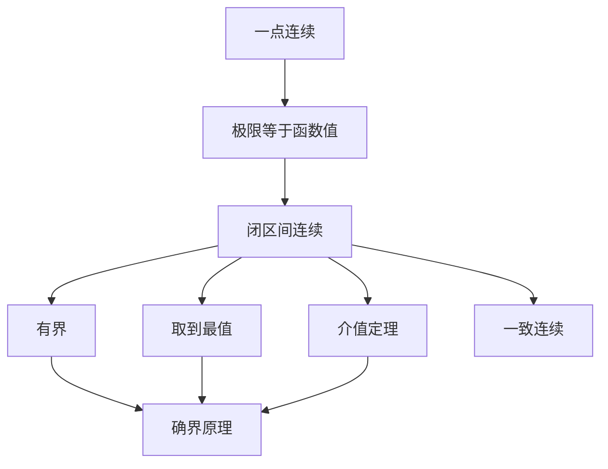

# 第 4 章：函数的连续性

- **难度**：★★☆ | **预估学时**：2.5 小时 | **前置**：第 3 章函数极限、邻域

## 学习目标

学完本章，你能：

1. 用"极限等于函数值"判定一点连续，并给间断点分类。
2. 说清闭区间上连续函数的四条定理各自的条件与结论。
3. 区分"连续"与"一致连续"，并各举一个例子。

## 一句话核心

连续就是把极限符号搬到函数值里面：$\lim f(x)=f(\lim x)$。所有连续函数的性质，都是这句话的推论。

## 零基础讲解

### 概念 1：一点连续与区间连续（难度：基础）

设 $f$ 在 $x_0$ 的某邻域内有定义。若

$$\lim_{x\to x_0}f(x)=f(x_0),$$

则称 $f$ 在 $x_0$ **连续**。

这个等式拆成三件事：极限存在、函数在该点有定义、两者相等。缺一条就不连续。

等价写法是增量式：$\lim_{\Delta x\to0}\Delta y=0$，其中 $\Delta y=f(x_0+\Delta x)-f(x_0)$。白话：自变量变一点点，函数值也只变一点点。

在开区间内每点连续，叫开区间上连续；在闭区间 $[a,b]$ 上连续，还要求在 $a$ 点右连续、$b$ 点左连续。

### 概念 2：间断点分类（难度：基础）

不连续的点叫间断点。按左右极限的存在情况分两类：

**第一类**：左右极限都存在。

- 左右相等但不等于函数值（或函数在该点无定义）：**可去间断点**。补一个定义就能连续。
- 左右不等：**跳跃间断点**。跳跃幅度是右极限减左极限。

**第二类**：左右极限至少有一个不存在。

- 函数值趋于无穷：**无穷间断点**，如 $\frac1x$ 在 0 点。
- 函数值来回震荡：**振荡间断点**，如 $\sin\frac1x$ 在 0 点。

例：$f(x)=\frac{\sin x}{x}$ 在 0 点无定义，但极限为 1，属可去间断点；$f(x)=\frac{|x|}{x}$ 在 0 点左极限 $-1$、右极限 1，属跳跃；$f(x)=\frac1{x^2}$ 在 0 点属无穷。

### 概念 3：连续函数的局部性质（难度：基础）

- **局部有界**：在 $x_0$ 连续，则存在邻域使 $f$ 有界。
- **局部保号**：若 $f(x_0)&gt;0$，则存在邻域使 $f(x)&gt;0$。
- **四则运算**：连续函数的和差积商（分母不为零）仍连续。
- **复合**：内层在 $x_0$ 连续、外层在 $u_0=g(x_0)$ 连续，则复合函数在 $x_0$ 连续。

这些性质都是把第 3 章的极限性质逐条搬过来，把"极限"换成"函数值"。

### 概念 4：闭区间上的四条定理（难度：进阶）

设 $f$ 在闭区间 $[a,b]$ 上连续。

1. **有界性**：$f$ 在 $[a,b]$ 上有界。
2. **最值性**：$f$ 在 $[a,b]$ 上取到最大值与最小值。
3. **介值性**：对任意介于 $f(a)$ 与 $f(b)$ 之间的 $c$，存在 $\xi\in[a,b]$ 使 $f(\xi)=c$。
4. **一致连续性**：对任意 $\varepsilon&gt;0$，存在只依赖 $\varepsilon$ 的 $\delta&gt;0$，使区间上任意两点 $|x_1-x_2|&lt;\delta$ 时都有 $|f(x_1)-f(x_2)|&lt;\varepsilon$。

前三条依赖实数完备性（确界原理与致密性定理），第四条是前三者的推论。注意"闭区间"三个字不能去掉：$f(x)=\frac1x$ 在 $(0,1)$ 上连续，但无界，也不一致连续。

**一致连续与连续的区别**：连续是"每点各自有一个 $\delta$"，$\delta$ 可以依赖点；一致连续是"整个区间共用一个 $\delta$"。前者像每家自备雨伞，后者像全城共用一把伞。

判断不一致连续常用否定式：找两列 $x_n,y_n$ 使 $|x_n-y_n|\to0$ 但 $|f(x_n)-f(y_n)|\ge\varepsilon_0$。$\frac1x$ 在 $(0,1)$ 上取 $x_n=\frac1n$、$y_n=\frac1{n+1}$，差值趋于 0，函数值差趋于 1。

### 概念 5：反函数与初等函数的连续性（难度：基础）

严格单调的连续函数，其反函数也连续。原因是单调保证一一对应，连续保证值域是区间，两者合起来反函数在每点都有极限且等于函数值。

初等函数在其定义区间内连续。这条结论的证明路径是：先证 $e^x$、$\ln x$、$\sin x$ 连续，再用复合与四则运算推广到全部初等函数。

## 图示

看图说明：四条定理都从"闭区间连续"出发，箭头指向确界原理，表示它们的证明最终都要回到实数完备性。这一层关系是第 7 章要展开的内容。

## 类比与实例

- 类比：连续像画线笔不离纸；一致连续像整条线都"同样平滑"，不会在某处突然变得极陡。$\frac1x$ 在 $(0,1)$ 上笔也没离纸，但靠近 0 时陡得没有统一标准，所以不一致连续。失效边界：这个类比只管"陡不陡"，不管"有没有断"。
- 实例：证明方程 $x^3-2x-5=0$ 在 $(2,3)$ 内有根。设 $f(x)=x^3-2x-5$，$f(2)=8-4-5=-1&lt;0$，$f(3)=27-6-5=16&gt;0$。$f$ 在 $[2,3]$ 连续，由介值定理存在 $\xi\in(2,3)$ 使 $f(\xi)=0$。

## 常见误解

- 别以为"函数在某点有定义就连续"——实际上还要极限存在且等于函数值。
- 别以为"连续函数一定可导"——实际上 $|x|$ 在 0 点连续但不可导，魏尔斯特拉斯函数处处连续但处处不可导。
- 别以为"开区间连续也有最值"——实际上最值定理要求闭区间，$(0,1)$ 上的 $x$ 取不到 1。
- 别以为"连续就一致连续"——实际上只在闭区间上成立，开区间与无穷区间都可能失效。

## 自测题（答案）

1. 单选：$f(x)=\frac{x^2-1}{x-1}$ 在 $x=1$ 处属于（ ）
   - A. 连续　B. 可去间断　C. 跳跃间断　D. 无穷间断

   **答案**：B。解析：$x\ne1$ 时 $f=x+1$，极限为 2，但函数在 1 处无定义，属可去间断。

2. 填空：$f(x)=\frac{|x|}{x}$ 在 $x=0$ 处的跳跃幅度是（ ）。

   **答案**：2。解析：右极限 1，左极限 $-1$，差为 2。

3. 简答：为什么 $f(x)=\frac1x$ 在 $(0,1)$ 上不一致连续？

   **答案**：取 $x_n=\frac1n$、$y_n=\frac1{n+1}$，则 $|x_n-y_n|\to0$，但 $|f(x_n)-f(y_n)|=|n-(n+1)|=1$，不趋于 0，所以不存在统一的 $\delta$。

## 复习锚点

- 连续的三要素：极限存在、有定义、两者相等。
- 间断点四类：可去、跳跃、无穷、振荡，前两类属第一类。
- 闭区间连续四定理的条件里，"闭"与"连续"都不能少。
