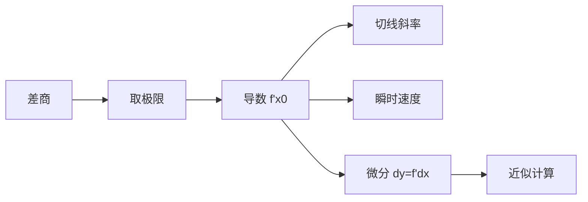

# 第 5 章：导数和微分

- **难度**：★★☆ | **预估学时**：3 小时 | **前置**：第 3、4 章极限与连续

## 学习目标

学完本章，你能：

1. 用定义算导数，并解释导数与切线斜率、瞬时速度的关系。
2. 熟练使用四则、复合、反函数三条求导法则。
3. 说明"可导必连续、连续未必可导"，并写出微分的定义与形式不变性。

## 一句话核心

导数是差商的极限，微分是函数增量的线性主部。前者描述"变多快"，后者描述"变化的主体量有多少"。

## 零基础讲解

### 概念 1：导数定义（难度：基础）

设 $f$ 在 $x_0$ 的某邻域内有定义。若极限

$$f'(x_0)=\lim_{\Delta x\to0}\frac{f(x_0+\Delta x)-f(x_0)}{\Delta x}$$

存在，则称 $f$ 在 $x_0$ **可导**，该极限叫导数。

三种写法等价：$f'(x_0)$、$\left.\frac{dy}{dx}\right|_{x_0}$、$\frac{df}{dx}(x_0)$。

几何意义：差商是割线斜率，$\Delta x\to0$ 时割线趋于切线，所以导数就是切线斜率。物理意义：位移对时间求导得速度，速度求导得加速度。

左右导数分别由 $\Delta x\to0^+$ 与 $0^-$ 定义。可导当且仅当左右导数存在且相等。

例：$f(x)=|x|$ 在 0 点，左导数 $-1$、右导数 1，不等，所以不可导。但它连续。这就给出那条常用结论：可导必连续，连续不必可导。

### 概念 2：求导法则（难度：基础）

**四则**：

$$(u\pm v)'=u'\pm v',\qquad (uv)'=u'v+uv',\qquad \left(\frac uv\right)'=\frac{u'v-uv'}{v^2}.$$

乘法法则的证明靠"加一项减一项"：$\Delta(uv)=u\Delta v+v\Delta u+\Delta u\Delta v$，最后一项是二阶小量，除以 $\Delta x$ 后趋于 0。

**反函数**：若 $y=f(x)$ 严格单调可导且 $f'(x)\ne0$，则反函数 $x=\varphi(y)$ 可导，且

$$\varphi'(y)=\frac{1}{f'(x)}.$$

这就是 $\frac{dx}{dy}=\frac{1}{dy/dx}$ 的来源。

**复合**：若 $u=g(x)$ 在 $x$ 可导、$y=f(u)$ 在 $u=g(x)$ 可导，则

$$(f\circ g)'(x)=f'(g(x))\cdot g'(x).$$

证明要用到"$\Delta u\to0$ 时 $\frac{\Delta y}{\Delta u}\to f'(u)$"，关键是 $g$ 在 $x$ 可导必连续，保证了 $\Delta u\to0$。

基本公式表要背熟：$(x^\alpha)'=\alpha x^{\alpha-1}$，$(\sin x)'=\cos x$，$(\cos x)'=-\sin x$，$(e^x)'=e^x$，$(\ln x)'=1/x$，$(\arctan x)'=1/(1+x^2)$。

### 概念 3：参变量函数与高阶导数（难度：进阶）

若曲线由 $x=\varphi(t)$、$y=\psi(t)$ 给出，且 $\varphi'(t)\ne0$，则

$$\frac{dy}{dx}=\frac{\psi'(t)}{\varphi'(t)}.$$

二阶导数不能直接再除一次，要写成

$$\frac{d^2y}{dx^2}=\frac{d}{dt}\left(\frac{\psi'(t)}{\varphi'(t)}\right)\Big/\varphi'(t).$$

分母再除以 $\varphi'$，因为对 $t$ 求导得到的是"对 t 的变化率"，还要换算成"对 x 的变化率"。

高阶导数记 $f^{(n)}(x)$。常用结论：$(e^x)^{(n)}=e^x$，$(\sin x)^{(n)}=\sin(x+n\pi/2)$，$(x^n)^{(n)}=n!$。

### 概念 4：微分（难度：进阶）

若函数增量可以写成

$$\Delta y=A\Delta x+o(\Delta x),$$

其中 $A$ 与 $\Delta x$ 无关，则称 $f$ 在 $x_0$ **可微**，$A\Delta x$ 叫微分，记 $dy=A\Delta x$。

定理：可微与可导等价，且 $A=f'(x_0)$。所以 $dy=f'(x)dx$。

**形式不变性**：无论 $x$ 是自变量还是中间变量，$dy=f'(u)du$ 都成立。这条性质让复合求导在微分写法下变得自然：一阶微分的形式不因换元而改变，二阶及更高阶就不再有这个性质。

**近似计算**：$f(x_0+\Delta x)\approx f(x_0)+f'(x_0)\Delta x$。例如 $\sqrt{1.02}\approx1+\frac12\cdot0.02=1.01$，真值 1.00995，误差约 5e-5。

## 图示

看图说明：中间是导数，向右分成三条用途：几何、物理、近似。做题时先问自己要哪一条，再决定用定义还是公式。

## 类比与实例

- 类比：导数像汽车仪表盘的瞬时读数，微分像"再开 0.01 秒会多走多少米"。前者是速率，后者是这段极短时间里的位移估计。失效边界：微分只是一阶近似，时间跨度一大就不准。
- 实例：求 $y=x^x$（$x&gt;0$）的导数。两边取对数 $\ln y=x\ln x$，对 $x$ 求导 $\frac{y'}{y}=\ln x+1$，所以 $y'=x^x(\ln x+1)$。这类"幂指函数"必须取对数，直接套幂函数或指数函数公式都会错。

## 常见误解

- 别以为"连续一定可导"——$|x|$ 在 0 点连续但左右导数不等。
- 别以为"$\frac{dy}{dx}$ 是分数"——它是整体记号，但在一阶微分里可以当分数做代数变形（形式不变性）。
- 别以为"参变量函数二阶导再除一次 $\varphi'$ 就行"——实际上要先对 $t$ 求导再除以 $\varphi'$。
- 别以为"微分就是很小的增量"——微分是增量的线性主部，$\Delta y=dy+o(\Delta x)$，两者差一个高阶小量。

## 自测题（答案）

1. 单选：$f(x)=|x|$ 在 $x=0$ 处（ ）
   - A. 可导且导数为 0　B. 连续但不可导　C. 不连续　D. 可导且导数为 1

   **答案**：B。解析：左右导数分别为 $-1$ 与 1，不相等。

2. 填空：$y=\ln\sin x$ 的导数是（ ）。

   **答案**：$\cot x$。解析：复合求导 $\frac{1}{\sin x}\cdot\cos x=\cot x$。

3. 简答：为什么 $y=x^x$ 不能直接写成 $x\cdot x^{x-1}$？

   **答案**：幂函数公式 $(x^\alpha)'=\alpha x^{\alpha-1}$ 要求指数是常数。这里底数和指数都在变，必须取对数化为 $\ln y=x\ln x$ 再求导。

## 复习锚点

- 导数定义是差商极限，几何上是切线斜率。
- 复合求导是"外层导数乘内层导数"，别漏内层。
- 可微与可导等价，一阶微分有形式不变性。
