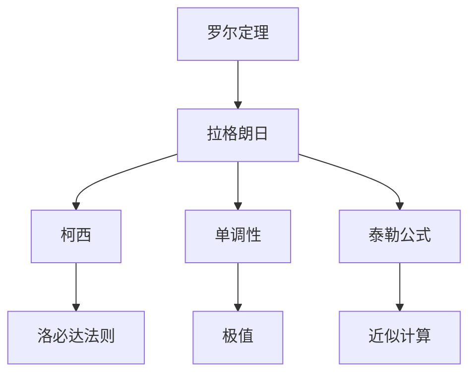

# 第 6 章：微分中值定理及其应用

- **难度**：★★★ | **预估学时**：4 小时 | **前置**：第 5 章导数、第 4 章闭区间连续性质

## 学习目标

学完本章，你能：

1. 写出罗尔、拉格朗日、柯西三条中值定理的条件与结论，并说明它们如何互相推出。
2. 用洛必达法则处理七种不定式。
3. 用导数判断单调性、极值、凹凸性与拐点，并写出泰勒公式的两种余项。

## 一句话核心

中值定理把"整体增量"换算成"某点导数"：$f(b)-f(a)=f'(\xi)(b-a)$。所有不等式证明、极限计算、函数作图，都是这条换算的延伸。

## 零基础讲解

### 概念 1：罗尔定理（难度：基础）

若 $f$ 在 $[a,b]$ 连续、在 $(a,b)$ 可导，且 $f(a)=f(b)$，则存在 $\xi\in(a,b)$ 使 $f'(\xi)=0$。

证明思路：闭区间连续必有最大最小值。若最值都在端点取到，则 $f$ 恒为常数，任取 $\xi$ 即可；否则最值在内部某点取到，该点是极值点，由费马引理导数为零。

费马引理：若 $x_0$ 是极值点且 $f$ 在该点可导，则 $f'(x_0)=0$。证明是左右导数分别非正、非负，夹出零。

### 概念 2：拉格朗日与柯西中值定理（难度：进阶）

**拉格朗日**：条件同罗尔但去掉 $f(a)=f(b)$，结论是存在 $\xi$ 使

$$f(b)-f(a)=f'(\xi)(b-a).$$

证法：构造辅助函数 $F(x)=f(x)-\frac{f(b)-f(a)}{b-a}(x-a)$，则 $F(a)=F(b)$，对 $F$ 用罗尔定理。

**柯西**：若 $f,g$ 都连续可导且 $g'(x)\ne0$，则存在 $\xi$ 使

$$\frac{f(b)-f(a)}{g(b)-g(a)}=\frac{f'(\xi)}{g'(\xi)}.$$

证法相同，辅助函数换成 $F(x)=f(x)(g(b)-g(a))-g(x)(f(b)-f(a))$。

拉格朗日是柯西在 $g(x)=x$ 时的特例。三者关系是：罗尔 → 拉格朗日 → 柯西，逐层放宽条件、加强结论。

### 概念 3：洛必达法则与不定式（难度：进阶）

处理 $\frac00$ 与 $\frac\infty\infty$ 型：若 $\lim\frac{f}{g}$ 是这两型，且 $\lim\frac{f'}{g'}$ 存在（或为无穷），则

$$\lim\frac{f(x)}{g(x)}=\lim\frac{f'(x)}{g'(x)}.$$

七种不定式：$\frac00$、$\frac\infty\infty$、$0\cdot\infty$、$\infty-\infty$、$1^\infty$、$0^0$、$\infty^0$。后五种要先化成前两种：取对数、通分、取倒数。

例：$\lim_{x\to0^+}x^x$。取对数得 $x\ln x$，这是 $0\cdot(-\infty)$ 型。写成 $\frac{\ln x}{1/x}$，用洛必达得 $\frac{1/x}{-1/x^2}=-x\to0$，所以原极限 $=e^0=1$。

注意：洛必达不是万能的。$\lim_{x\to\infty}\frac{x+\sin x}{x}$ 用洛必达会得到 $1+\cos x$ 震荡，但原式直接等于 $1+\frac{\sin x}{x}\to1$。导数比的极限不存在时，原极限仍可能存在。

### 概念 4：单调性、极值与凸性（难度：基础）

- **单调**：$f'&gt;0$ 则严格增，$f'&lt;0$ 则严格减。证明用拉格朗日：任取 $x_1&lt;x_2$，$f(x_2)-f(x_1)=f'(\xi)(x_2-x_1)$，符号由导数决定。
- **极值**：必要条件 $f'(x_0)=0$（驻点）或导数不存在。充分条件看导数变号：左正右负为极大，左负右正为极小。
- **凸性**：$f''&gt;0$ 为凹（开口向上，曲线在切线上方），$f''&lt;0$ 为凸（开口向下）。$f''$ 变号的点是拐点。

教材的凹凸命名与部分书相反，判断时以"$f''$ 的符号"为准，不要只记名字。

### 概念 5：泰勒公式（难度：高难）

若 $f$ 在 $x_0$ 处有 $n$ 阶导数，则

$$f(x)=\sum_{k=0}^{n}\frac{f^{(k)}(x_0)}{k!}(x-x_0)^k+R_n(x).$$

两种余项：

- **佩亚诺**：$R_n(x)=o((x-x_0)^n)$，只说明误差阶，用于求极限。
- **拉格朗日**：$R_n(x)=\frac{f^{(n+1)}(\xi)}{(n+1)!}(x-x_0)^{n+1}$，能估计误差大小，用于近似计算。

常用展开（$x\to0$）：$e^x=1+x+\frac{x^2}{2}+\cdots$，$\sin x=x-\frac{x^3}{6}+\cdots$，$\ln(1+x)=x-\frac{x^2}{2}+\cdots$，$(1+x)^\alpha=1+\alpha x+\frac{\alpha(\alpha-1)}{2}x^2+\cdots$。

## 图示

看图说明：左边一条链是"定理逐步放宽"，右边三条是从拉格朗日分出的应用分支。图里没有单独画"不等式证明"，因为它同时用 B 与 E 两条。

## 类比与实例

- 类比：中值定理像"平均速度等于某个瞬时速度"。开车两小时走 120 公里，平均时速 60，那么途中至少有一刻仪表盘显示 60。失效边界：要求路程函数连续且可导，跳变或急刹的位置导数不存在时结论不成立。
- 实例：证明 $x&gt;0$ 时 $\ln(1+x)&lt;x$。设 $f(t)=\ln(1+t)$，在 $[0,x]$ 上用拉格朗日：$\ln(1+x)-\ln1=\frac{1}{1+\xi}x$，$\xi\in(0,x)$。因为 $\frac{1}{1+\xi}&lt;1$，所以 $\ln(1+x)&lt;x$。

## 常见误解

- 别以为"驻点一定是极值点"——$x^3$ 在 0 点导数为 0，但那里不是极值。
- 别以为"洛必达用一次就完事"——实际上可能要多次，每次都要重新检查是否仍是 $\frac00$ 或 $\frac\infty\infty$。
- 别以为"泰勒展开的余项可以随便丢"——用佩亚诺余项求极限时要保证展开阶数足够，否则会丢掉主项。
- 别以为"$f''&gt;0$ 叫凸函数"——不同教材命名相反，记符号不记名字。

## 自测题（答案）

1. 单选：$f(x)=x^3$ 在 $[-1,1]$ 上满足拉格朗日定理，中值 $\xi$ 等于（ ）
   - A. 0　B. $\frac{1}{\sqrt3}$　C. $\frac12$　D. 不存在

   **答案**：B。解析：$f(1)-f(-1)=2$，$f'(\xi)=3\xi^2$，由 $3\xi^2\cdot2=2$ 得 $\xi^2=\frac13$，取 $\xi=\frac{1}{\sqrt3}$。

2. 填空：$\lim_{x\to0}\frac{e^x-1-x}{x^2}=$（ ）。

   **答案**：$\frac12$。解析：$e^x=1+x+\frac{x^2}{2}+o(x^2)$，代入得 $\frac{x^2/2+o(x^2)}{x^2}\to\frac12$。

3. 简答：为什么洛必达法则在 $\lim_{x\to\infty}\frac{x+\sin x}{x}$ 上失效？

   **答案**：求导后为 $\frac{1+\cos x}{1}$，极限不存在；但原式等于 $1+\frac{\sin x}{x}\to1$。法则要求导数比的极限存在，条件不满足。

## 复习锚点

- 三条中值定理是一条链：罗尔 → 拉格朗日 → 柯西，辅助函数是证法的核心。
- 洛必达只对 $\frac00$ 与 $\frac\infty\infty$，且要求导数比极限存在。
- 泰勒公式的两种余项各有用途：佩亚诺求极限，拉格朗日估误差。
