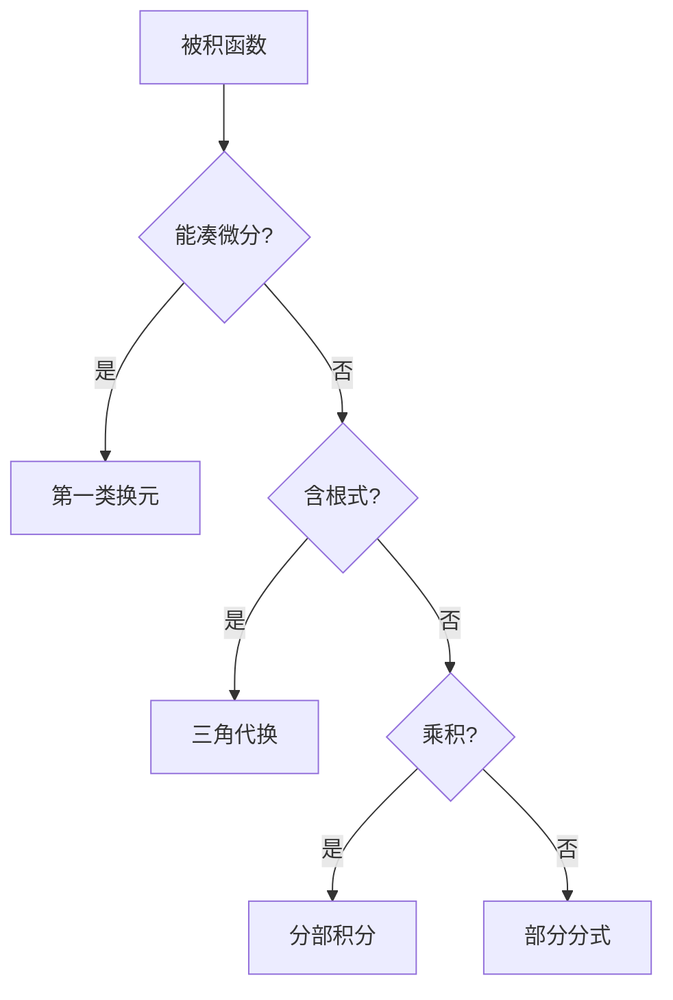

# 第 8 章：不定积分

- **难度**：★★☆ | **预估学时**：3 小时 | **前置**：第 5、6 章求导与中值定理

## 学习目标

学完本章，你能：

1. 写出原函数与不定积分的关系，并说明为什么差一个常数。
2. 熟练使用换元法与分部积分法。
3. 把有理函数拆成部分分式再积分。

## 一句话核心

不定积分就是求导的逆运算：找一个函数，使它的导数等于被积函数。所有技巧都是为了把陌生的积分化成基本公式表里的样子。

## 零基础讲解

### 概念 1：原函数与不定积分（难度：基础）

若 $F'(x)=f(x)$，称 $F$ 是 $f$ 的一个**原函数**。若 $F$ 是原函数，则 $F+C$ 也是，且所有原函数都差一个常数（由第 6 章拉格朗日中值定理推出：导数处处为零的函数是常数）。

$f$ 的全体原函数叫**不定积分**，记

$$\int f(x)\,dx=F(x)+C.$$

基本公式表要从导数表反推：

$$\int x^\alpha dx=\frac{x^{\alpha+1}}{\alpha+1}+C\ (\alpha\ne-1),\quad \int\frac{dx}{x}=\ln|x|+C,$$
$$\int e^xdx=e^x+C,\quad \int\sin x\,dx=-\cos x+C,\quad \int\frac{dx}{1+x^2}=\arctan x+C.$$

不定积分的结果必须带 $C$，求导验证时 $C$ 消掉，这是检查答案的最快办法。

### 概念 2：换元积分法（难度：进阶）

**第一类（凑微分）**：$\int f(\varphi(x))\varphi'(x)dx=\int f(u)du$，其中 $u=\varphi(x)$。

例：$\int x e^{x^2}dx=\frac12\int e^{u}du=\frac12e^{x^2}+C$，其中 $u=x^2$，$du=2x\,dx$。

**第二类（变量代换）**：$\int f(x)dx=\int f(\psi(t))\psi'(t)dt$，其中 $x=\psi(t)$。

例：$\int\sqrt{a^2-x^2}dx$，令 $x=a\sin t$，$dx=a\cos t\,dt$，原式 $=a^2\int\cos^2t\,dt=\frac{a^2}{2}\left(t+\frac{\sin2t}{2}\right)+C$，再代回 $t=\arcsin\frac xa$。

第二类换元要求 $\psi$ 严格单调可导，否则回代时多值。三角代换的三种对应：$\sqrt{a^2-x^2}$ 用 $x=a\sin t$，$\sqrt{a^2+x^2}$ 用 $x=a\tan t$，$\sqrt{x^2-a^2}$ 用 $x=a\sec t$。

### 概念 3：分部积分法（难度：进阶）

$$\int u\,dv=uv-\int v\,du.$$

它来自乘积求导公式的移项。使用的关键是选对 $u$：选"求导后变简单"的因子当 $u$，选"容易积分"的因子当 $dv$。

常用优先级（口诀"反对幂三指"）：反三角、对数、幂函数、三角、指数，排在前面的优先当 $u$。

例：$\int x\ln x\,dx$。取 $u=\ln x$，$dv=x\,dx$，则 $du=\frac{dx}{x}$，$v=\frac{x^2}{2}$，原式 $=\frac{x^2}{2}\ln x-\int\frac{x}{2}dx=\frac{x^2}{2}\ln x-\frac{x^2}{4}+C$。

有些积分要连续分部两次，如 $\int e^x\sin x\,dx$，两次后出现原积分，移项解出。

### 概念 4：有理函数的积分（难度：进阶）

有理函数 $\frac{P(x)}{Q(x)}$ 的积分分三步：

1. 若分子次数不低于分母，先做多项式除法。
2. 把分母因式分解成一次与二次不可约因式。
3. 按因式写部分分式，再逐项积分。

部分分式的四种基本项：

$$\frac{A}{x-a},\quad \frac{A}{(x-a)^k},\quad \frac{Bx+C}{x^2+px+q},\quad \frac{Bx+C}{(x^2+px+q)^k}.$$

前两类积出对数与幂函数；后两类配方后用 $\arctan$ 与递推公式。

例：$\int\frac{dx}{x^2-1}=\frac12\int\left(\frac{1}{x-1}-\frac{1}{x+1}\right)dx=\frac12\ln\left|\frac{x-1}{x+1}\right|+C$。

## 图示

看图说明：四个判断节点对应四条主路。实际做题时常要组合：先换元化简，再分部，最后部分分式。

## 类比与实例

- 类比：不定积分像"根据速度记录反推位置"。记录只给速度，位置可以差一个初始偏移，那个偏移就是 $C$。失效边界：速度记录必须连续，跳变处无法反推。
- 实例：$\int\frac{dx}{x^2+2x+5}$。配方得 $(x+1)^2+4$，令 $u=x+1$，原式 $=\int\frac{du}{u^2+4}=\frac12\arctan\frac{u}{2}+C=\frac12\arctan\frac{x+1}{2}+C$。

## 常见误解

- 别以为"不定积分结果唯一"——实际上差常数，答案不写 $C$ 就是错的。
- 别以为"换元后可以直接把 $t$ 留在答案里"——不定积分必须回代成 $x$。
- 别以为"分部积分随便选 $u$"——选错会让积分越算越复杂，按"反对幂三指"顺序选。
- 别以为"所有初等函数都有初等原函数"——$e^{-x^2}$、$\frac{\sin x}{x}$ 的原函数都不是初等函数。

## 自测题（答案）

1. 单选：$\int\frac{dx}{x\ln x}$ 等于（ ）
   - A. $\ln|x|+C$　B. $\ln|\ln x|+C$　C. $\frac{1}{\ln x}+C$　D. $x\ln x+C$

   **答案**：B。解析：令 $u=\ln x$，$du=\frac{dx}{x}$，积分为 $\ln|u|+C$。

2. 填空：$\int x\cos x\,dx=$（ ）。

   **答案**：$x\sin x+\cos x+C$。解析：$u=x$，$dv=\cos x\,dx$，得 $x\sin x-\int\sin x\,dx=x\sin x+\cos x+C$。

3. 简答：为什么 $\int\frac{dx}{x^2-1}$ 要拆成部分分式？

   **答案**：分母可分解为 $(x-1)(x+1)$，拆成两个一次因式后分别积出对数；不拆则没有直接可用的基本公式。

## 复习锚点

- 不定积分求完必须求导验证，$C$ 是检查点。
- 三角代换三种对应要记牢，回代别忘。
- 分部积分选 $u$ 的顺序：反对幂三指。
