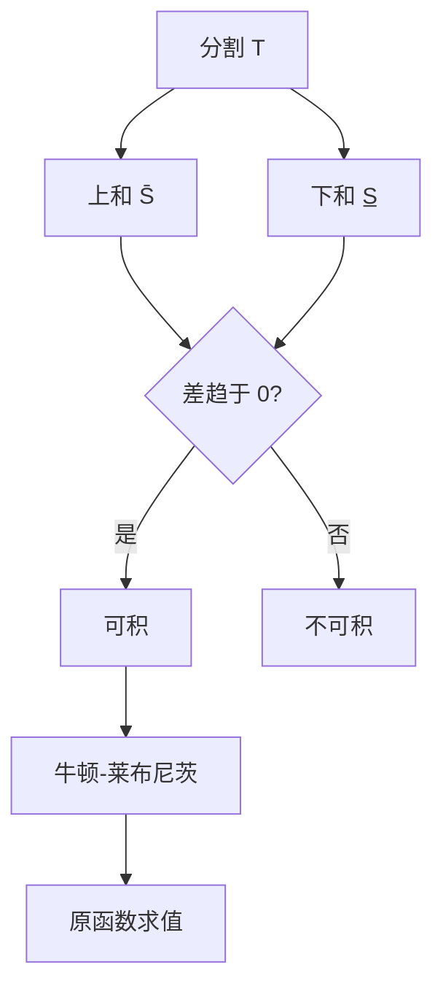

# 第 9 章：定积分

- **难度**：★★★ | **预估学时**：4 小时 | **前置**：第 7 章完备性、第 8 章不定积分

## 学习目标

学完本章，你能：

1. 用分割、取点、求和的极限写出定积分定义，并说明达布和与它的关系。
2. 写出可积的充要条件，判断哪些函数可积。
3. 用牛顿-莱布尼茨公式、换元与分部计算定积分。

## 一句话核心

定积分是"把无穷多个无穷小加起来"的严格化：分割越细，上和与下和越挤到同一个数，这个数就是积分。

## 零基础讲解

### 概念 1：定义与达布和（难度：高难）

设 $f$ 在 $[a,b]$ 有界。作分割 $T$：$a=x_0<x_1<\cdots<x_n=b$，在每个小区间取点 $\xi_i$，作和

$$S=\sum_{i=1}^{n}f(\xi_i)\Delta x_i.$$

若分割的细度 $\|T\|=\max\Delta x_i\to0$ 时，$S$ 的极限存在且与取点无关，则称 $f$ 在 $[a,b]$ **可积**，该极限记

$$\int_a^b f(x)\,dx.$$

达布和是"最保守与最乐观"的两个和：在小区间上取上确界 $M_i$ 得上和 $\overline S=\sum M_i\Delta x_i$，取下确界 $m_i$ 得下和 $\underline S=\sum m_i\Delta x_i$。可积的充要条件是

$$\lim_{\|T\|\to0}\left(\overline S-\underline S\right)=0.$$

这条判据的价值在于：不用管取点，只看上和与下和的差。上和的下确界与下和的上确界相等时，那个共同值就是积分。

### 概念 2：可积函数类（难度：进阶）

- 闭区间上连续函数可积。
- 闭区间上只有有限个间断点的有界函数可积。
- 闭区间上单调有界函数可积。

证明思路统一：用一致连续（连续情形）或振幅估计（有限间断、单调情形）把 $\overline S-\underline S$ 压到任意小。

反例：狄利克雷函数（有理点取 1，无理点取 0）在 $[0,1]$ 上不可积，因为任意分割的上和恒为 1、下和恒为 0，差永远压不下去。

### 概念 3：定积分的性质（难度：基础）

- 线性：$\int(\alpha f+\beta g)=\alpha\int f+\beta\int g$。
- 区间可加：$\int_a^b=\int_a^c+\int_c^b$。
- 保号：$f\ge0$ 则 $\int_a^b f\ge0$；由此得 $|\int f|\le\int|f|$。
- 估值：$m(b-a)\le\int_a^b f\le M(b-a)$。
- 积分中值定理：$f$ 连续时存在 $\xi\in[a,b]$ 使 $\int_a^b f=f(\xi)(b-a)$。

积分中值定理的证明用最值定理加介值定理：把 $\frac{1}{b-a}\int f$ 看作函数值的平均，它介于最小值与最大值之间，由介值性必被某点取到。

### 概念 4：牛顿-莱布尼茨公式与变限积分（难度：进阶）

设 $f$ 在 $[a,b]$ 连续，定义变上限积分

$$\Phi(x)=\int_a^x f(t)\,dt.$$

则 $\Phi'(x)=f(x)$。证明用导数定义与积分中值定理：$\frac{\Phi(x+\Delta x)-\Phi(x)}{\Delta x}=\frac{1}{\Delta x}\int_x^{x+\Delta x}f(t)dt=f(\xi)\to f(x)$。

由此得**牛顿-莱布尼茨公式**：

$$\int_a^b f(x)dx=F(b)-F(a),$$

其中 $F$ 是 $f$ 的任一原函数。这条公式把定积分从"求和的极限"变成"原函数在两端点的差"，是整门课效率提升最大的一步。

变限积分还有两个变形：$\frac{d}{dx}\int_{a}^{\varphi(x)}f(t)dt=f(\varphi(x))\varphi'(x)$；上下限都变时拆成两段再各自求导。

### 概念 5：定积分的计算（难度：进阶）

换元要注意换限：$x=\psi(t)$ 时，$x=a$ 对应 $t=\alpha$，$x=b$ 对应 $t=\beta$，积分变成 $\int_\alpha^\beta f(\psi(t))\psi'(t)dt$。不回代，直接算数值。

分部积分：$\int_a^b u\,dv=[uv]_a^b-\int_a^b v\,du$。

对称性技巧：$\int_{-a}^{a}f(x)dx$ 在 $f$ 为奇函数时等于 0，偶函数时等于 $2\int_0^a f$。周期函数在一个周期上的积分与起点无关。

## 图示

看图说明：左边是定义层，右边是计算层。两层之间靠"可积"打通，连续函数必然可积，所以实际计算可以直接跳到 G。

## 类比与实例

- 类比：定积分像用很多细长方形拼出曲边图形的面积。分割越细，锯齿越小，面积越接近真值。失效边界：函数必须"不太野"，振幅不能在某处无限大。
- 实例：$\int_0^1 x^2dx$。原函数 $\frac{x^3}{3}$，代入得 $\frac13$。用定义验证：上和 $\sum\frac{i^2}{n^3}=\frac{n(n+1)(2n+1)}{6n^3}\to\frac13$，一致。

## 常见误解

- 别以为"可积就必须连续"——实际上有限个间断点的有界函数也可积。
- 别以为"定积分就是面积"——函数取负值时积分为负，面积要取绝对值再积分。
- 别以为"换元后还把 $t$ 换回 $x$"——定积分换元必须换限，算出数值即可。
- 别以为"$\int_a^b f$ 的值依赖原函数选择"——不同原函数差常数，代入两端相减后抵消。

## 自测题（答案）

1. 单选：下列函数在 $[0,1]$ 上不可积的是（ ）
   - A. $x^2$　B. $\frac1x$（补充定义 $f(0)=0$）　C. 狄利克雷函数　D. $\sin x$

   **答案**：C。解析：狄利克雷函数上下和恒差 1；$1/x$ 补充定义后在 $[0,1]$ 上无界，也不可积，但题目中 A、D 显然可积，C 是标准反例。

2. 填空：$\frac{d}{dx}\int_0^{x^2}\sin t\,dt=$（ ）。

   **答案**：$2x\sin x^2$。解析：变上限复合求导 $f(\varphi(x))\varphi'(x)$。

3. 简答：为什么牛顿-莱布尼茨公式要求 $f$ 连续？

   **答案**：公式依赖变上限积分可导且导数等于 $f$，这需要 $f$ 连续；若 $f$ 有跳跃，$\Phi$ 在该点不可导，公式要分段使用。

## 复习锚点

- 可积判据：上和与下和之差趋于零。
- 连续、有限间断、单调有界三类函数可积。
- 牛顿-莱布尼茨公式把积分化为原函数求值，前提是连续。
