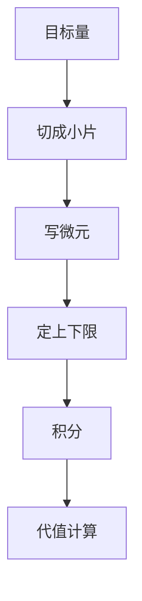

# 第 10 章：定积分的应用

- **难度**：★★☆ | **预估学时**：3 小时 | **前置**：第 9 章定积分、第 5 章导数

## 学习目标

学完本章，你能：

1. 用直角坐标与参数方程求平面图形面积。
2. 用平行截面法求体积，用弧长公式求曲线长度与曲率。
3. 求旋转曲面面积，并把功、液体压力这类物理量写成积分。

## 一句话核心

定积分应用只有一个模板：把目标量切成小片，写出一片的近似（微元），再积分。面积、体积、弧长、功都是同一个模板的不同微元。

## 零基础讲解

### 概念 1：平面图形的面积（难度：基础）

直角坐标下，由 $y=f(x)$、$y=g(x)$、$x=a$、$x=b$ 围成的区域面积

$$A=\int_a^b|f(x)-g(x)|\,dx.$$

绝对值不能省：两条曲线谁在上面可能中途换位，先求交点分段，再逐段去掉绝对值。

参数方程 $x=x(t)$、$y=y(t)$ 围成的面积用

$$A=\int_{t_1}^{t_2}y(t)x'(t)\,dt.$$

极坐标下，由 $r=r(\theta)$ 与两条射线围成的扇形面积

$$A=\frac12\int_{\alpha}^{\beta}r^2(\theta)\,d\theta.$$

这个 $\frac12$ 来自扇形面积 $\frac12r^2\Delta\theta$，是最典型的"微元"。

### 概念 2：体积（难度：基础）

**平行截面法**：若立体在 $x$ 处的截面面积为 $A(x)$，则

$$V=\int_a^b A(x)\,dx.$$

旋转体是特例：$y=f(x)$ 绕 $x$ 轴旋转，截面是半径 $|f(x)|$ 的圆，$V=\pi\int_a^b f^2(x)dx$。

绕 $y$ 轴旋转用柱壳法：$V=2\pi\int_a^b x|f(x)|dx$，微元是周长 $2\pi x$、高 $f(x)$、厚 $dx$ 的薄壳。

例：$y=x^2$ 在 $[0,1]$ 上绕 $x$ 轴，$V=\pi\int_0^1x^4dx=\frac{\pi}{5}$。

### 概念 3：弧长与曲率（难度：进阶）

直角坐标弧长

$$s=\int_a^b\sqrt{1+[f'(x)]^2}\,dx.$$

参数方程 $s=\int_{t_1}^{t_2}\sqrt{[x'(t)]^2+[y'(t)]^2}\,dt$。极坐标 $s=\int_\alpha^\beta\sqrt{r^2+[r'(\theta)]^2}\,d\theta$。

三条公式共用一个结构：$\sqrt{(dx)^2+(dy)^2}$，只是换了参数。

**曲率**：描述曲线弯曲程度，定义为单位弧长上切线转过的角度，

$$\kappa=\frac{|y''|}{(1+y'^2)^{3/2}}.$$

曲率半径 $\rho=1/\kappa$。直线曲率为 0，半径无穷；圆半径为 $R$ 时曲率为 $1/R$。

### 概念 4：旋转曲面的面积（难度：进阶）

$y=f(x)$ 绕 $x$ 轴旋转，侧面积

$$S=2\pi\int_a^b|f(x)|\sqrt{1+[f'(x)]^2}\,dx.$$

注意根号不能漏：曲面面积不是把曲线长度乘周长，而是每一小段弧长 $ds$ 乘该处的周长 $2\pi|f(x)|$，再积分。

对比圆台侧面积公式 $S=\pi(r_1+r_2)l$，当 $r_1\approx r_2$ 时退化为 $2\pi rl$，与微元一致。

### 概念 5：物理应用（难度：基础）

- **变力做功**：$W=\int_a^b F(x)dx$。
- **液体静压力**：$P=\int_a^b\rho g\,h(x)\cdot L(x)\,dx$，$h$ 是深度，$L$ 是宽度。
- **质心**：$\bar x=\frac{1}{A}\int_a^b x|f(x)-g(x)|dx$。
- **转动惯量**：$I=\int x^2\,dm$，细棒 $I=\int_a^b\rho x^2dx$。

这类题的共同点：先把物理量写成"密度 × 微小几何量"，再套积分。单位要统一，否则结果量纲不对。

## 图示

看图说明：五步是固定流程，中间没有分支。最容易错的是第三步：微元写错，后面全错；其次是第四步：上下限搞反会得负值。

## 类比与实例

- 类比：微元法像用纸带量曲线长度。把纸带剪成极短的小段，每段近似直线，量出长度再相加。失效边界：段必须足够短，曲线不能在一段里打结。
- 实例：求 $r=a(1+\cos\theta)$ 围成的面积。$A=\frac12\int_0^{2\pi}a^2(1+\cos\theta)^2d\theta$。展开 $(1+\cos\theta)^2=1+2\cos\theta+\cos^2\theta$，一个周期上 $\cos\theta$ 积分为 0，$\cos^2\theta$ 积分为 $\pi$，所以 $A=\frac{a^2}{2}(2\pi+\pi)=\frac{3\pi a^2}{2}$。

## 常见误解

- 别以为"面积积分不用管上下位置"——两条曲线交叉时要分段，否则会算出抵消后的净值。
- 别以为"旋转体体积就是底面积乘高"——截面变化时必须积分。
- 别以为"弧长等于弦长之和"——折线长度是下界，极限才等于弧长。
- 别以为"旋转曲面面积等于弧长乘周长"——必须用 $ds$ 与局部周长相乘再积分。

## 自测题（答案）

1. 单选：$y=x^2$ 在 $[0,2]$ 上绕 $x$ 轴旋转所得体积为（ ）
   - A. $\frac{32\pi}{5}$　B. $\frac{8\pi}{3}$　C. $\frac{16\pi}{5}$　D. $4\pi$

   **答案**：A。解析：$\pi\int_0^2x^4dx=\pi\cdot\frac{32}{5}$。

2. 填空：圆 $x^2+y^2=R^2$ 的曲率为（ ）。

   **答案**：$1/R$。解析：圆的切线转角与弧长之比恒为 $1/R$。

3. 简答：为什么旋转曲面面积公式里要带 $\sqrt{1+y'^2}$？

   **答案**：微元是"弧长 $ds$ × 该处周长 $2\pi|y|$"，而 $ds=\sqrt{1+y'^2}dx$。漏掉它就变成用水平宽度代替弧长，曲面会被算小。

## 复习锚点

- 微元法五步：切、写、定限、积分、代值。
- 面积带绝对值，体积看截面，弧长看 $ds$。
- 极坐标面积有 $\frac12$，绕 $y$ 轴用柱壳。
