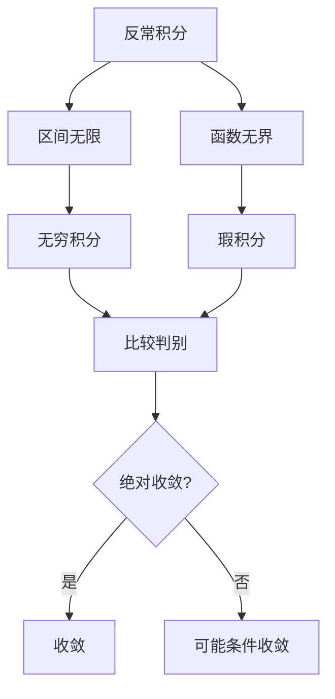

# 第 11 章：反常积分

- **难度**：★★★ | **预估学时**：3 小时 | **前置**：第 9 章定积分、第 2 章极限

## 学习目标

学完本章，你能：

1. 写出无穷积分与瑕积分的定义，判断一个反常积分属于哪一类。
2. 用比较判别法、狄利克雷判别法判断收敛性。
3. 区分绝对收敛与条件收敛，并各举一例。

## 一句话核心

反常积分只是把定积分的两个边界放开：或者积分区间无限，或者被积函数在某点无界。所有定义都用"先积到有限处，再取极限"的方式写，绝不直接对无穷求和。

## 零基础讲解

### 概念 1：无穷积分的定义（难度：基础）

设 $f$ 在 $[a,+\infty)$ 上有定义且在任何有限区间上可积。若极限

$$\lim_{b\to+\infty}\int_a^b f(x)dx$$

存在，称无穷积分 $\int_a^{+\infty}f(x)dx$ **收敛**，该极限值就是积分值；否则称**发散**。

关键：先算有限上限的定积分，再让上限趋于无穷。不能把 $\infty$ 当普通数代入。

例：$\int_1^{+\infty}\frac{dx}{x^p}$。$p\ne1$ 时 $\int_1^b\frac{dx}{x^p}=\frac{b^{1-p}-1}{1-p}$。当 $p&gt;1$，$b^{1-p}\to0$，积分收敛于 $\frac{1}{p-1}$；当 $p&lt;1$，$b^{1-p}\to\infty$，发散；$p=1$ 时为 $\ln b\to\infty$，发散。

结论要背下来：$\int_1^\infty\frac{dx}{x^p}$ 当且仅当 $p&gt;1$ 收敛。

### 概念 2：瑕积分的定义（难度：基础）

若 $f$ 在 $a$ 的右邻域无界（$a$ 叫瑕点），定义

$$\int_a^b f(x)dx=\lim_{\varepsilon\to0^+}\int_{a+\varepsilon}^b f(x)dx.$$

瑕点可能在端点，也可能在区间内部。在内部时要拆成两段，两边都收敛才算收敛。

例：$\int_0^1\frac{dx}{x^p}$。$p&lt;1$ 时收敛，$p\ge1$ 时发散。这与无穷积分的方向正好相反，因为一个是"趋于 0 时被积函数爆掉"，一个是"趋于无穷时衰减不够"。

统一记法：两类反常积分可以互相转化（作倒数代换 $x=1/t$），所以判别法只需学一套。

### 概念 3：收敛判别法（难度：进阶）

**比较判别法**：若 $0\le f(x)\le g(x)$ 且 $\int g$ 收敛，则 $\int f$ 收敛；若 $\int f$ 发散，则 $\int g$ 发散。

**极限比较法**：若 $\lim\frac{f(x)}{g(x)}=c$（$c\ne0$ 或 $\infty$），则两者同敛散。

**狄利克雷判别法**：若 $\int_a^A f$ 对一切 $A$ 有界，$g$ 单调且 $g(x)\to0$，则 $\int_a^\infty fg$ 收敛。

**阿贝尔判别法**：$\int f$ 收敛，$g$ 单调有界，则 $\int fg$ 收敛。

例：$\int_1^\infty\frac{\sin x}{x}dx$ 收敛。$\int\sin x$ 有界，$\frac1x$ 单调趋于 0，由狄利克雷判别法得收敛。

### 概念 4：绝对收敛与条件收敛（难度：进阶）

若 $\int|f|$ 收敛，称 $\int f$ **绝对收敛**；若 $\int f$ 收敛但 $\int|f|$ 发散，称**条件收敛**。

$\int_1^\infty\frac{\sin x}{x}dx$ 是条件收敛：本身收敛，但 $|\frac{\sin x}{x}|$ 的积分发散（用 $|\sin x|\ge\sin^2x$ 放缩，得下界 $\int\frac{\sin^2x}{x}$，它与 $\int\frac{1}{2x}$ 同阶，发散）。

绝对收敛必收敛，反之不成立。这条性质在级数里同样成立。

### 概念 5：计算与主值（难度：进阶）

收敛的反常积分可以直接用牛顿-莱布尼茨公式加极限：

$$\int_a^\infty f=F(+\infty)-F(a),\quad F(+\infty)=\lim_{x\to\infty}F(x).$$

分部、换元在收敛的前提下照常使用。

**柯西主值**：对 $\int_{-\infty}^\infty f$，若 $\int_0^\infty$ 与 $\int_{-\infty}^0$ 各自发散，但 $\lim_{R\to\infty}\int_{-R}^{R}f$ 存在，称该极限为主值。主值存在不等于积分收敛，只是对称截断后的极限。

## 图示

看图说明：两类入口汇到同一套判别法，最后分叉出绝对收敛与条件收敛。考判断时先定类型，再选判别法，最后查绝对值。

## 类比与实例

- 类比：反常积分像往无底桶里倒水。倒的速度（被积函数）必须衰减得够快，桶才不会满；$\frac1x$ 衰减太慢，水一直积；$\frac{1}{x^2}$ 衰减够快，总量有限。失效边界：这里说的是"总量有限"，桶本身永远装不满。
- 实例：$\int_0^{+\infty}e^{-x}dx$。先算 $\int_0^b e^{-x}dx=1-e^{-b}$，令 $b\to\infty$ 得 1，收敛。$\int_1^\infty\frac{dx}{\sqrt x}$ 则发散，因为 $p=\frac12&lt;1$。

## 常见误解

- 别以为"被积函数趋于 0 就收敛"——$\frac1x$ 趋于 0，但积分发散。
- 别以为"瑕积分和无穷积分的判别方向一样"——$p$ 的判断正好相反。
- 别以为"收敛就一定绝对收敛"——$\frac{\sin x}{x}$ 是反例。
- 别以为"主值存在就是收敛"——主值只是对称截断的极限，$\int_{-\infty}^\infty x\,dx$ 主值为 0 但不收敛。

## 自测题（答案）

1. 单选：$\int_1^{+\infty}\frac{dx}{x^{3/2}}$ 的敛散性是（ ）
   - A. 收敛　B. 发散　C. 条件收敛　D. 无法判断

   **答案**：A。解析：$p=\frac32&gt;1$，收敛。

2. 填空：$\int_0^1\frac{dx}{\sqrt x}=$（ ）。

   **答案**：2。解析：$\int_\varepsilon^1x^{-1/2}dx=2(1-\sqrt\varepsilon)\to2$。

3. 简答：说明 $\int_1^\infty\frac{\sin x}{x}dx$ 条件收敛。

   **答案**：收敛由狄利克雷判别法（$\int\sin x$ 有界、$1/x$ 单调趋于 0）；绝对值发散因为 $|\sin x|\ge\sin^2x$，而 $\int\frac{\sin^2x}{x}$ 与 $\int\frac{1}{2x}$ 同阶发散。

## 复习锚点

- 两类反常积分都靠"先有限、再取极限"定义。
- $\int_1^\infty x^{-p}$：$p&gt;1$ 收敛；$\int_0^1x^{-p}$：$p&lt;1$ 收敛。
- 绝对收敛必收敛，条件收敛是另一个层次。
