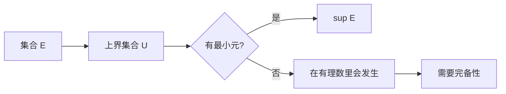

# 上确界

- **难度**：高难 | **涉及章节**：第 1、2、7 章

## 一句话定义

上确界是全体上界里最小的那个；换一种说法，它是"能被集合任意逼近、但绝不被超过"的天花板。

## 为什么重要

它是实数完备性的第一条可用结论。后面证明单调有界准则、闭区间连续函数取最值、介值定理，第一步都是"取上确界"。没有它，分析里一半的存在性定理没有落脚点。

## 图示

看图说明：上确界不是先有集合再去找，而是先在"上界集合"里找最小元。图中分叉说明：上界集合未必有最小元，补上这个最小元就是实数完备性干的事。

## 详解

设 $E$ 非空。$\eta=\sup E$ 的完整判定是两条：

1. 对一切 $x\in E$，$x\le\eta$（是上界）。
2. 对任意 $\varepsilon&gt;0$，存在 $x_0\in E$，使 $x_0&gt;\eta-\varepsilon$（最小）。

第二条等价于"任何比 $\eta$ 小的数都不是上界"。做题时经常只用第二条来找矛盾：假设某个 $\eta'&lt;\eta$ 也是上界，由第二条取 $\varepsilon=\eta-\eta'$，立刻有元素超过 $\eta'$，与上界定义冲突。

例子：$E=\{1-\frac1n\}$。$\sup E=1$。验证第二条：给定 $\varepsilon$，要 $1-\frac1n&gt;1-\varepsilon$，即 $n&gt;1/\varepsilon$，取 $n=\lfloor 1/\varepsilon\rfloor+1$ 即可。这个验证过程就是"上确界"这个词的全部内容。

反例：把 $E$ 换成 $\{x\in\mathbb{Q}:x^2&lt;2\}$。它在 $\mathbb{Q}$ 中有上界（2 就是），但没有最小上界。假设有最小上界 $q\in\mathbb{Q}$，则 $q^2=2$ 或 $q^2&gt;2$ 或 $q^2&lt;2$。$q^2=2$ 不可能（$\sqrt2$ 无理）；$q^2&gt;2$ 时可以构造更小的有理上界；$q^2&lt;2$ 时 $q$ 根本不是上界。三条都堵死，说明最小上界不存在。

## 常见误解

- 以为上确界必须属于集合。$(0,1)$ 的 1 就在外面。
- 以为"有上界"就等于"有上确界"。在实数里成立，在有理数里不成立，区别来自完备性。
- 把上确界与最大值混用。最大值要求取到，上确界只要求逼近。

## 在书中出现的脉络

| 章节 | 语境 | 关键结论 |
|---|---|---|
| 1 | 确界原理 | 非空有上界必有上确界 |
| 2 | 单调有界准则 | 用 $\sup\{a_n\}$ 当极限 |
| 7 | 实数完备性六定理 | 确界原理与其余五条等价 |
| 9 | 可积性 | 达布上和的下确界定义积分 |

## 相关概念

- 前置：不等式、绝对值
- 后续：单调有界准则、区间套定理、达布和
