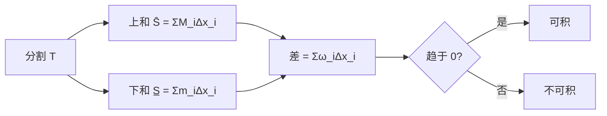

# 可积性与达布和

- **难度**：高难 | **涉及章节**：第 9、10、21 章

## 一句话定义

可积的意思是：分割足够细以后，所有取点方式算出的和都挤到同一个数，上和与下和的差可以压到任意小。

## 为什么重要

它把"面积"从直观变成定理。判断一个函数能不能积分，不看图像，看 $\overline S-\underline S$ 是否趋于 0。二重、三重积分的可积性判据也是这一条的翻版。

## 图示

看图说明：ω_i 是振幅 $M_i-m_i$。可积性完全由振幅的总加权和控制，与自己取哪个点无关。

## 详解

达布和的性质：加细分割时，上和减小、下和增大；上和的下确界记 $\overline I$，下和的上确界记 $\underline I$，恒有 $\underline I\le\overline I$。

可积的充要条件：$\overline I=\underline I$，等价于对任意 $\varepsilon>0$ 存在分割使 $\overline S-\underline S<\varepsilon$。

三类可积函数：

- 连续函数：用一致连续，把每个小区间的振幅压到 $\varepsilon/(b-a)$ 以下。
- 有限个间断点的有界函数：把间断点附近的小区间单独拎出，其总长度任意小。
- 单调有界函数：振幅之和 telescopes 成端点的差，乘最大步长即趋于 0。

反例：狄利克雷函数，任意分割的振幅都是 1，$\overline S-\underline S=b-a$ 永不趋于 0。

二重积分的达布和是 $\sum M_{ij}\Delta\sigma_{ij}$，判据完全相同。

## 常见误解

- 以为"有界就可积"。狄利克雷函数有界但不可积。
- 以为"可积必须连续"。有限个间断点的有界函数仍可积。
- 以为"$\int$ 一定存在"。写积分前先问可积性，尤其在反常积分与多重积分里。

## 在书中出现的脉络

| 章节 | 语境 | 关键结论 |
|---|---|---|
| 9 | 定积分定义 | 达布和与可积判据 |
| 10 | 应用 | 微元法默认可积 |
| 21 | 重积分 | 二重达布和 |
| 21 | 反常二重积分 | 无界区域上的推广 |

## 相关概念

- 前置：确界、一致连续
- 后续：定积分性质、重积分、含参量积分
