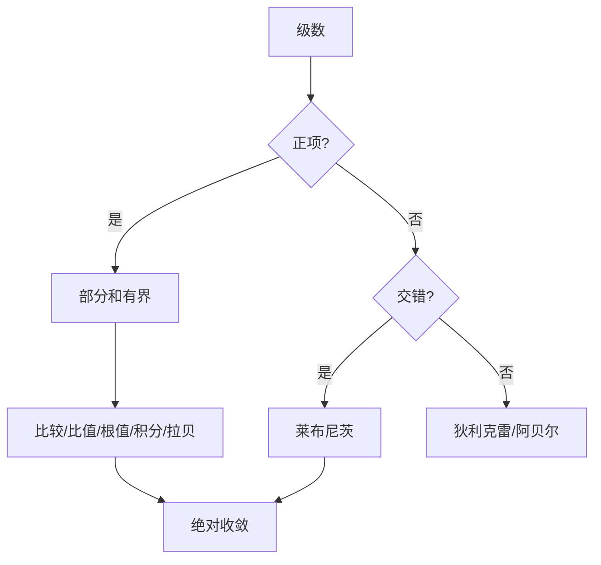

# 第 12 章：数项级数

- **难度**：★★★ | **预估学时**：4 小时 | **前置**：第 2 章数列极限、第 11 章反常积分

## 学习目标

学完本章，你能：

1. 用部分和数列定义级数收敛，写出收敛的必要条件。
2. 对正项级数选用比较、比值、根值、积分、拉贝判别法。
3. 判断交错级数与一般项级数的收敛性，区分绝对收敛与条件收敛。

## 一句话核心

级数就是把数列一项项加起来，但"加无穷多项"没有直接意义，所以定义成部分和数列的极限。

## 零基础讲解

### 概念 1：收敛与部分和（难度：基础）

给定数列 $\{u_n\}$，记部分和 $S_n=u_1+u_2+\cdots+u_n$。若 $\lim_{n\to\infty}S_n=S$ 存在，称级数 $\sum_{n=1}^\infty u_n$ 收敛，和为 $S$。

两个基本结论：

- 若级数收敛，则 $u_n\to0$。这是必要条件，不是充分条件：调和级数 $\sum\frac1n$ 的项趋于 0，但发散。
- 收敛级数可以逐项相加、数乘，收敛级数的和满足线性运算。

**柯西准则**：$\sum u_n$ 收敛的充要条件是对任意 $\varepsilon&gt;0$，存在 $N$，当 $m&gt;n&gt;N$ 时 $|u_{n+1}+\cdots+u_m|&lt;\varepsilon$。

调和级数发散的证明用柯西准则或分组放缩：$\frac13+\frac14&gt;\frac12$，$\frac15+\cdots+\frac18&gt;\frac12$，每组都能凑出 $\frac12$，部分和无界。

### 概念 2：正项级数判别法（难度：进阶）

正项级数的部分和单调递增，所以"收敛"与"部分和有界"等价。这条性质让正项级数的判别变得简单。

**比较判别法**：若 $0\le u_n\le v_n$，$\sum v_n$ 收敛则 $\sum u_n$ 收敛；$\sum u_n$ 发散则 $\sum v_n$ 发散。极限形式：$\lim\frac{u_n}{v_n}=c$（$0&lt;c&lt;\infty$）时同敛散。

**比值判别法**：$\lim\frac{u_{n+1}}{u_n}=q$。$q&lt;1$ 收敛，$q&gt;1$ 发散，$q=1$ 失效。

**根值判别法**：$\lim\sqrt[n]{u_n}=q$，判据同上。

**积分判别法**：$u_n=f(n)$，$f$ 单调递减非负，则 $\sum u_n$ 与 $\int_1^\infty f(x)dx$ 同敛散。$p$ 级数 $\sum\frac{1}{n^p}$ 当且仅当 $p&gt;1$ 收敛，就是用这条证。

**拉贝判别法**：$\lim n\left(\frac{u_n}{u_{n+1}}-1\right)=r$。$r&gt;1$ 收敛，$r&lt;1$ 发散。它用于比值法失效（$q=1$）的场合，比如 $\sum\frac{(2n-1)!!}{(2n)!!}\frac{1}{2n+1}$。

### 概念 3：一般项级数（难度：进阶）

**交错级数（莱布尼茨判别法）**：$u_n$ 单调递减且趋于 0，则 $\sum(-1)^{n-1}u_n$ 收敛，且余项绝对值不超过 $u_{n+1}$。

**绝对收敛**：$\sum|u_n|$ 收敛，则 $\sum u_n$ 收敛。绝对收敛的级数可以重排。

**条件收敛**：$\sum u_n$ 收敛但 $\sum|u_n|$ 发散。$\sum\frac{(-1)^{n-1}}{n}$ 是标准例子。条件收敛的级数重排会改变和，这一点由黎曼重排定理保证。

**狄利克雷判别法**：$\sum a_n$ 的部分和有界，$b_n$ 单调趋于 0，则 $\sum a_nb_n$ 收敛。

**阿贝尔判别法**：$\sum a_n$ 收敛，$b_n$ 单调有界，则 $\sum a_nb_n$ 收敛。

例：$\sum\frac{\sin n}{n}$ 收敛。$\sum\sin n$ 的部分和有界（用和差化积可估），$\frac1n$ 单调趋于 0，由狄利克雷判别法得收敛；绝对值 $\sum\frac{|\sin n|}{n}$ 发散，所以是条件收敛。

## 图示

看图说明：先分正项与非正项，非正项再看交错与一般。所有路径最后都要回到"绝对值收敛吗"这一问题，答案决定用哪种性质。

## 类比与实例

- 类比：级数像往账户里连续存款，每笔越来越少。余额是否停在某个数，取决于是不是"衰减得够快"。$\frac1n$ 存得不够快，余额一直涨。失效边界：这里只看总量，不看每笔的正负。
- 实例：判断 $\sum\frac{n}{2^n}$。比值 $\frac{u_{n+1}}{u_n}=\frac{n+1}{2n}\to\frac12&lt;1$，收敛。求和可用错位相减，结果为 2。

## 常见误解

- 别以为"$u_n\to0$ 就收敛"——调和级数是反例。
- 别以为"比值法失效就是发散"——$q=1$ 时要用拉贝或比较判别法。
- 别以为"收敛级数可以随便交换项"——只有绝对收敛才可以。
- 别以为"交错级数一定收敛"——还要 $u_n$ 单调趋于 0。

## 自测题（答案）

1. 单选：$\sum\frac{1}{n^{1.1}}$ 的敛散性是（ ）
   - A. 收敛　B. 发散　C. 条件收敛　D. 无法判断

   **答案**：A。解析：$p=1.1&gt;1$。

2. 填空：$\sum_{n=1}^\infty\frac{1}{n(n+1)}=$（ ）。

   **答案**：1。解析：裂项 $\frac1n-\frac1{n+1}$，部分和为 $1-\frac1{n+1}\to1$。

3. 简答：为什么 $\sum\frac{(-1)^{n-1}}{n}$ 是条件收敛？

   **答案**：本身由莱布尼茨判别法收敛（单调递减趋于 0）；绝对值是调和级数，发散。

## 复习锚点

- 收敛必要条件 $u_n\to0$，只用来排除发散。
- 正项级数看部分和有界，五条判别法按适用场景选。
- 绝对收敛可重排，条件收敛不可。
