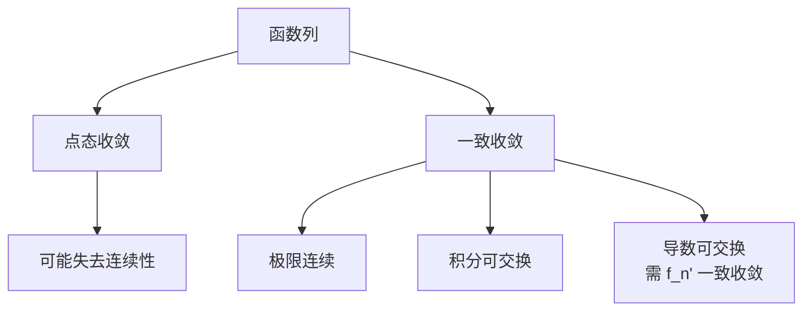

# 第 13 章：函数列与函数项级数

- **难度**：★★★ | **预估学时**：4 小时 | **前置**：第 12 章级数、第 4 章一致连续

## 学习目标

学完本章，你能：

1. 区分点态收敛与一致收敛，写出各自定义。
2. 用 $M$ 判别法证明函数项级数一致收敛。
3. 说明一致收敛为什么能保证极限函数连续、可积、可导。

## 一句话核心

函数列收敛有两种：每点各自收敛（点态），和整段一起收敛（一致）。只有后者能把"极限"与"连续、积分、求导"交换次序。

## 零基础讲解

### 概念 1：点态收敛与一致收敛（难度：高难）

设 $f_n$ 在 $D$ 上有定义。若对每个 $x\in D$，数列 $f_n(x)$ 收敛，记 $f(x)=\lim f_n(x)$，称 $f_n$ **点态收敛**于 $f$。

点态收敛的问题是：收敛速度可以随 $x$ 变化。$f_n(x)=x^n$ 在 $[0,1]$ 上点态收敛于 $f(x)=0$（$x<1$）与 $f(1)=1$。极限函数在 1 处不连续，尽管每个 $f_n$ 都连续。

**一致收敛**：若对任意 $\varepsilon>0$，存在只依赖 $\varepsilon$ 的 $N$，使 $n>N$ 时对一切 $x\in D$ 都有

$$|f_n(x)-f(x)|<\varepsilon,$$

则称 $f_n$ 在 $D$ 上一致收敛于 $f$。

区别在 $N$ 的位置：点态是 $\forall x\exists N$，一致是 $\exists N\forall x$。$N$ 必须在 $x$ 之前定好。

**一致收敛的柯西准则**：$f_n$ 一致收敛的充要条件是对任意 $\varepsilon>0$，存在 $N$，当 $m,n>N$ 时对一切 $x$ 都有 $|f_n(x)-f_m(x)|<\varepsilon$。

实用判据是上确界：$\sup_{x\in D}|f_n(x)-f(x)|\to0$。

### 概念 2：函数项级数的一致收敛（难度：进阶）

$\sum u_n(x)$ 一致收敛指部分和函数列 $S_n(x)$ 一致收敛。

**魏尔斯特拉斯判别法（M 判别法）**：若 $|u_n(x)|\le M_n$ 对一切 $x$ 成立，且 $\sum M_n$ 收敛，则 $\sum u_n(x)$ 一致收敛。这是最常用的一条。

**狄利克雷与阿贝尔的一致版**：把"部分和有界"换成"部分和一致有界"，"单调"换成"对每个 $x$ 单调且一致有界"，结论照样成立。

例：$\sum\frac{\sin nx}{n^2}$ 在 $\mathbb{R}$ 上一致收敛。因为 $|\frac{\sin nx}{n^2}|\le\frac{1}{n^2}$，而 $\sum\frac{1}{n^2}$ 收敛。

$\sum\frac{(-1)^n}{n+x}$ 在 $[0,+\infty)$ 上一致收敛，用狄利克雷判别法：$\sum(-1)^n$ 部分和一致有界，$\frac{1}{n+x}$ 对每个 $x$ 单调递减且一致趋于 0。

### 概念 3：一致收敛的三条交换性质（难度：进阶）

1. **连续性**：$f_n$ 连续且一致收敛于 $f$，则 $f$ 连续。证明用"三段 $\varepsilon/3$"：$|f(x)-f(x_0)|\le|f(x)-f_n(x)|+|f_n(x)-f_n(x_0)|+|f_n(x_0)-f(x_0)|$，第一、三项由一致收敛控制，中间项由 $f_n$ 连续控制。
2. **可积性**：$f_n$ 在 $[a,b]$ 上可积且一致收敛，则 $\lim\int f_n=\int f$。误差被 $\varepsilon(b-a)$ 控制。
3. **可导性**：若 $f_n$ 在 $[a,b]$ 上可导，$f_n'$ 一致收敛，且 $f_n$ 在某点收敛，则 $f_n$ 一致收敛于 $f$，且 $f'=\lim f_n'$。这条要求最强，导数一致收敛不能省。

反例说明可导性为何需要额外条件：$f_n(x)=\frac{\sin nx}{n}$ 一致收敛于 0，$f_n'(x)=\cos nx$ 不一致收敛，极限导数不存在。

### 概念 4：幂级数与后续（难度：基础）

函数项级数最重要的特例是幂级数 $\sum a_n(x-x_0)^n$，它有一个收敛区间，在区间内绝对收敛、在区间外发散。这部分内容在第 14 章展开。

## 图示

看图说明：左侧点态收敛只有一条路，右边一致收敛有三条交换性质。图里 G 是反例警示，$x^n$ 就挂在那个位置。

## 类比与实例

- 类比：点态收敛像各班各自考试，谁先交卷不一定；一致收敛像统一铃声，到点全体交卷。失效边界：一致收敛要求"全体同时达标"，比点态严格。
- 实例：$f_n(x)=\frac{x}{1+nx}$ 在 $[0,1]$ 上。$f_n(0)=0$，$x>0$ 时 $f_n(x)\to0$，所以点态收敛于 0。是否一致？$\sup|f_n(x)|=\frac{1}{1+n}$（在 $x=1$ 处），趋于 0，所以一致收敛。

## 常见误解

- 别以为"点态收敛就一致收敛"——$x^n$ 在 $[0,1]$ 上点态收敛，但 $\sup|x^n-0|=1$，不一致。
- 别以为"M 判别法是必要条件"——它只是充分条件，不满足它也未必不一致收敛。
- 别以为"一致收敛可以随便交换求导"——需要导数列一致收敛。
- 别以为"逐点连续就能推出极限连续"——必须一致收敛。

## 自测题（答案）

1. 单选：$f_n(x)=x^n$ 在 $[0,1]$ 上（ ）
   - A. 一致收敛于 0　B. 点态收敛但不一致收敛　C. 不收敛　D. 一致收敛于 1

   **答案**：B。解析：$x<1$ 时趋于 0，$x=1$ 时为 1；$\sup|x^n-0|=1$ 不趋于 0。

2. 填空：$\sum\frac{\cos nx}{n^3}$ 在 $\mathbb{R}$ 上是否一致收敛？（ ）

   **答案**：是。解析：$|\frac{\cos nx}{n^3}|\le\frac{1}{n^3}$，$\sum\frac{1}{n^3}$ 收敛，由 M 判别法。

3. 简答：为什么一致收敛能保证极限函数连续？

   **答案**：用三段估计：$|f(x)-f(x_0)|\le|f(x)-f_n(x)|+|f_n(x)-f_n(x_0)|+|f_n(x_0)-f(x_0)|$。前后两项由一致收敛统一控制，中间项由 $f_n$ 连续控制，总误差小于 $\varepsilon$。

## 复习锚点

- 点态与一致的区别只在 $N$ 与 $x$ 的顺序。
- M 判别法是最常用的充分条件。
- 连续性、积分、求导三条交换性质，条件依次加强。
