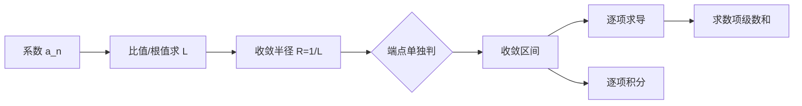

# 第 14 章：幂级数

- **难度**：★★★ | **预估学时**：3 小时 | **前置**：第 13 章一致收敛、第 6 章泰勒公式

## 学习目标

学完本章，你能：

1. 用比值或根值求幂级数的收敛半径与收敛区间。
2. 说明幂级数在收敛区间内可以逐项求导、逐项积分。
3. 把常见初等函数展开成幂级数，并写出欧拉公式。

## 一句话核心

幂级数是最"听话"的函数项级数：它在收敛区间内绝对收敛、可以随便求导积分，收敛半径由系数决定。

## 零基础讲解

### 概念 1：收敛半径与阿贝尔定理（难度：进阶）

幂级数 $\sum_{n=0}^\infty a_n(x-x_0)^n$ 的收敛性只有三种可能：只在 $x_0$ 收敛、在某个区间 $|x-x_0|&lt;R$ 内收敛而在外部发散、在整个 $\mathbb{R}$ 收敛。

**阿贝尔定理**：若在 $x_1$ 收敛，则对一切 $|x-x_0|&lt;|x_1-x_0|$ 绝对收敛；若在 $x_2$ 发散，则对一切 $|x-x_0|&gt;|x_2-x_0|$ 发散。

**收敛半径的求法**：设 $\lim\left|\frac{a_{n+1}}{a_n}\right|=L$ 或 $\lim\sqrt[n]{|a_n|}=L$，则

$$R=\frac{1}{L},$$

其中 $L=0$ 时 $R=\infty$，$L=\infty$ 时 $R=0$。

端点 $x=x_0\pm R$ 要单独判别，可能收敛也可能发散。收敛区间可能是开区间、闭区间或半开半闭。

例：$\sum\frac{x^n}{n}$。$L=1$，$R=1$。$x=1$ 时为调和级数发散，$x=-1$ 时为交错调和级数收敛，所以收敛区间是 $[-1,1)$。

### 概念 2：幂级数的性质（难度：进阶）

在收敛区间内部（不含端点）：

- 和函数连续。
- 可以逐项求导：$S'(x)=\sum na_n(x-x_0)^{n-1}$，收敛半径不变。
- 可以逐项积分：$\int_{x_0}^xS(t)dt=\sum\frac{a_n}{n+1}(x-x_0)^{n+1}$，收敛半径不变。

求导与积分不改变收敛半径，但端点处的敛散性可能改变。这一点常用于求某些数项级数的和。

例：由 $\frac{1}{1-x}=\sum x^n$（$|x|&lt;1$），逐项求导得 $\frac{1}{(1-x)^2}=\sum nx^{n-1}$，于是 $\sum\frac{n}{2^n}=2$。

### 概念 3：函数展开成幂级数（难度：进阶）

若 $f$ 在 $x_0$ 处有任意阶导数，其泰勒级数为 $\sum\frac{f^{(n)}(x_0)}{n!}(x-x_0)^n$。这个级数是否收敛到 $f$，要看余项是否趋于 0，不能默认成立。

常用展开式（$x\to0$）：

$$e^x=\sum\frac{x^n}{n!},\quad \sin x=\sum\frac{(-1)^n x^{2n+1}}{(2n+1)!},\quad \cos x=\sum\frac{(-1)^n x^{2n}}{(2n)!},$$
$$\ln(1+x)=\sum\frac{(-1)^{n-1}x^n}{n}\ (-1&lt;x\le1),\quad (1+x)^\alpha=1+\alpha x+\frac{\alpha(\alpha-1)}{2!}x^2+\cdots$$

展开方法有三种：直接求导代入、利用已知展开式做代换或四则运算、逐项求导积分。做题时优先用后两种，避免高阶导数算错。

例：$\frac{1}{1+x^2}=\sum(-1)^nx^{2n}$（$|x|&lt;1$），积分得 $\arctan x=\sum\frac{(-1)^n x^{2n+1}}{2n+1}$，端点 $x=\pm1$ 也收敛。

### 概念 4：欧拉公式（难度：进阶）

把 $e^{ix}$ 按实幂级数展开（形式上允许复数），得

$$e^{ix}=\cos x+i\sin x.$$

由此得 $\cos x=\frac{e^{ix}+e^{-ix}}{2}$，$\sin x=\frac{e^{ix}-e^{-ix}}{2i}$。这条公式把三角与指数连起来，是复变函数与傅里叶分析的入口。

## 图示

看图说明：从系数出发先定半径，再单独查两端。右侧两条性质都只在区间内部成立，端点要重新验证。

## 类比与实例

- 类比：幂级数像显微镜的调焦范围。在焦内（收敛区间）看得清，超出就糊（发散），边界处可能勉强能看也可能不能。失效边界：边界必须单独试。
- 实例：求 $\sum\frac{x^n}{n!}$ 的收敛半径。比值 $\frac{a_{n+1}}{a_n}=\frac{1}{n+1}\to0$，所以 $R=\infty$，收敛区间为 $\mathbb{R}$，和函数是 $e^x$。

## 常见误解

- 别以为"收敛半径内一定收敛到原函数"——幂级数可能收敛到别的函数，要查余项。
- 别以为"求导后收敛区间不变"——半径不变，但端点可能变化。
- 别以为"$R=1/L$ 对缺项级数也直接可用"——缺项时要用根值法或整体处理。
- 别以为"端点一定收敛或一定发散"——必须逐题代入判断。

## 自测题（答案）

1. 单选：$\sum\frac{x^n}{2^n}$ 的收敛半径是（ ）
   - A. $\frac12$　B. 1　C. 2　D. $\infty$

   **答案**：C。解析：$a_n=2^{-n}$，$L=\frac12$，$R=2$。

2. 填空：$\sum_{n=0}^\infty\frac{x^n}{n!}$ 的和函数是（ ）。

   **答案**：$e^x$。解析：这是 $e^x$ 的麦克劳林展开，收敛区间为 $\mathbb{R}$。

3. 简答：为什么幂级数在收敛区间内可以逐项求导？

   **答案**：求导后的级数收敛半径不变，在区间内部（取 $|x-x_0|&lt;r&lt;R$）可由 M 判别法证明一致收敛，再由一致收敛的求导性质交换次序。

## 复习锚点

- 收敛半径 $R=1/L$，端点单独判。
- 区间内可逐项求导积分，半径不变。
- 常用五个展开式要能默写。
