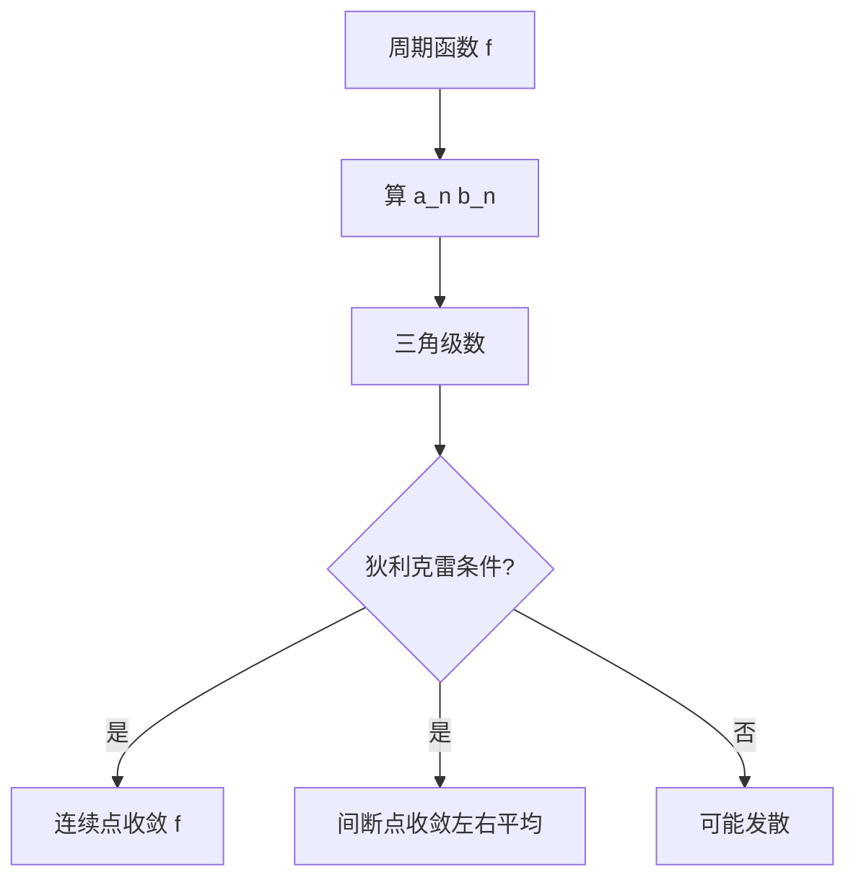

# 第 15 章：傅里叶级数

- **难度**：★★★ | **预估学时**：3.5 小时 | **前置**：第 12 章级数、第 13 章一致收敛

## 学习目标

学完本章，你能：

1. 写出三角系的正交关系，并用它推出傅里叶系数公式。
2. 写出收敛定理的条件，判断一个函数展开后的收敛情况。
3. 把 $2\pi$ 周期与 $2l$ 周期函数展开，处理奇偶延拓。

## 一句话核心

傅里叶级数把函数拆成不同频率的 sine 与 cos 的叠加；系数靠正交性算，不靠求导。

## 零基础讲解

### 概念 1：三角系的正交性（难度：基础）

三角系 $1,\cos x,\sin x,\cos2x,\sin2x,\dots$ 在 $[-\pi,\pi]$ 上两两正交：

$$\int_{-\pi}^{\pi}\cos nx\cos mx\,dx=0\ (n\ne m),\quad \int_{-\pi}^{\pi}\cos nx\sin mx\,dx=0,$$

而 $\int_{-\pi}^{\pi}\cos^2nx\,dx=\pi$，$\int_{-\pi}^{\pi}\sin^2nx\,dx=\pi$，$\int_{-\pi}^{\pi}1\,dx=2\pi$。

正交性的用处：把它当作"内积"，求系数时两边乘一个基函数再积分，其他项全消掉。这与向量的投影是同一件事。

### 概念 2：傅里叶系数（难度：基础）

设 $f$ 在 $[-\pi,\pi]$ 上可积，定义

$$a_n=\frac{1}{\pi}\int_{-\pi}^{\pi}f(x)\cos nx\,dx,\quad b_n=\frac{1}{\pi}\int_{-\pi}^{\pi}f(x)\sin nx\,dx,$$

$a_0=\frac{1}{\pi}\int_{-\pi}^{\pi}f(x)dx$。对应的三角级数

$$f(x)\sim\frac{a_0}{2}+\sum_{n=1}^\infty(a_n\cos nx+b_n\sin nx)$$

叫 $f$ 的傅里叶级数。这里写"$\sim$"不写"$=$"，因为级数是否收敛到 $f$ 还要看条件。

例：$f(x)=x$ 在 $[-\pi,\pi]$ 上是奇函数，所以 $a_n=0$，$b_n=\frac{1}{\pi}\int_{-\pi}^{\pi}x\sin nx\,dx=\frac{2(-1)^{n-1}}{n}$。级数为 $2\sum\frac{(-1)^{n-1}}{n}\sin nx$。

### 概念 3：收敛定理（难度：进阶）

**狄利克雷条件**：$f$ 在 $[-\pi,\pi]$ 上连续或只有有限个第一类间断点，且只有有限个极值点。满足时，傅里叶级数收敛，且

- 在连续点收敛到 $f(x)$；
- 在间断点收敛到 $\frac{f(x+)+f(x-)}{2}$（左右极限的平均）。
- 在端点 $x=\pm\pi$，收敛到 $\frac{f(-\pi+)+f(\pi-)}{2}$。

这条定理解释了 $f(x)=x$ 在 $x=\pi$ 处的现象：级数收敛到 0，不是 $\pi$，因为端点要取左右极限平均。

代入 $x=\frac\pi2$ 可得 $\frac\pi4=1-\frac13+\frac15-\cdots$，这是傅里叶级数最常用的副产品。

### 概念 4：2l 周期与奇偶延拓（难度：进阶）

对周期 $2l$ 的函数，把 $x$ 换成 $\frac{\pi x}{l}$，基函数变为 $\cos\frac{n\pi x}{l}$、$\sin\frac{n\pi x}{l}$，系数为

$$a_n=\frac{1}{l}\int_{-l}^{l}f(x)\cos\frac{n\pi x}{l}dx,\quad b_n=\frac{1}{l}\int_{-l}^{l}f(x)\sin\frac{n\pi x}{l}dx.$$

若 $f$ 只在 $[0,l]$ 上给出，可以延拓：

- **偶延拓**：$f(-x)=f(x)$，展开为余弦级数，$b_n=0$。
- **奇延拓**：$f(-x)=-f(x)$，展开为正弦级数，$a_n=0$。

例：$f(x)=x$ 在 $[0,\pi]$ 上作偶延拓，得余弦级数 $\frac\pi2-\frac{4}{\pi}\sum\frac{\cos(2n-1)x}{(2n-1)^2}$，在 $x=0$ 处收敛到 0（左右平均）。

### 概念 5：帕塞瓦尔等式（难度：进阶）

若 $f$ 平方可积，则

$$\frac{a_0^2}{2}+\sum_{n=1}^\infty(a_n^2+b_n^2)=\frac{1}{\pi}\int_{-\pi}^{\pi}f^2(x)dx.$$

它说的是"能量守恒"：函数的总能量等于各频率分量能量之和。用它可求一些数项级数的和，例如由 $f(x)=x$ 得 $\sum\frac{1}{n^2}=\frac{\pi^2}{6}$。

## 图示

看图说明：中间是系数计算，右侧是收敛判定。F 那一支专门处理跳跃点，考试里最容易漏。

## 类比与实例

- 类比：傅里叶级数像把一段音乐拆成不同音高的音量。每个 $a_n$、$b_n$ 是某个频率的音量旋钮，把它们调回去就还原原声。失效边界：只对"不太野"的函数成立，无限尖峰的函数拆不干净。
- 实例：方波 $f(x)=1$（$0<x<\pi$）、$-1$（$-\pi<x<0$）。奇函数，$a_n=0$，$b_n=\frac{2}{n\pi}(1-\cos n\pi)$，偶数项为 0，奇数项为 $\frac{4}{n\pi}$。级数为 $\frac4\pi\left(\sin x+\frac{\sin3x}{3}+\cdots\right)$。

## 常见误解

- 别以为"傅里叶级数处处等于原函数"——间断点与端点收敛到左右平均。
- 别以为"$a_0$ 就是平均值"——$a_0/2$ 才是平均值，公式里除以 2。
- 别以为"奇函数一定有 $a_0=0$"——奇函数在对称区间积分为 0，所以 $a_0=0$，但偶函数不一定 $b_n=0$ 之外还有别的项。
- 别以为"延拓方式可以随便选"——偶延拓得余弦，奇延拓得正弦，选错会把端点值算错。

## 自测题（答案）

1. 单选：$f(x)=x$ 在 $[-\pi,\pi]$ 上的傅里叶系数满足（ ）
   - A. $a_n=0$，$b_n\ne0$　B. $a_n\ne0$，$b_n=0$　C. 两者都非零　D. 两者都为零

   **答案**：A。解析：$x$ 是奇函数，与 $\cos nx$ 正交，$a_n=0$；与 $\sin nx$ 内积非零。

2. 填空：$f(x)=x$ 的傅里叶级数在 $x=\pi$ 处收敛到（ ）。

   **答案**：0。解析：端点取左右极限平均 $\frac{-\pi+\pi}{2}=0$。

3. 简答：偶延拓后展开式里为什么没有正弦项？

   **答案**：偶函数与奇函数 $\sin\frac{n\pi x}{l}$ 的乘积是奇函数，在对称区间积分为 0，所以 $b_n=0$。

## 复习锚点

- 正交性推出系数公式，$a_0$ 要除以 2。
- 收敛定理三条：连续点、间断点、端点。
- 偶延拓余弦，奇延拓正弦。
