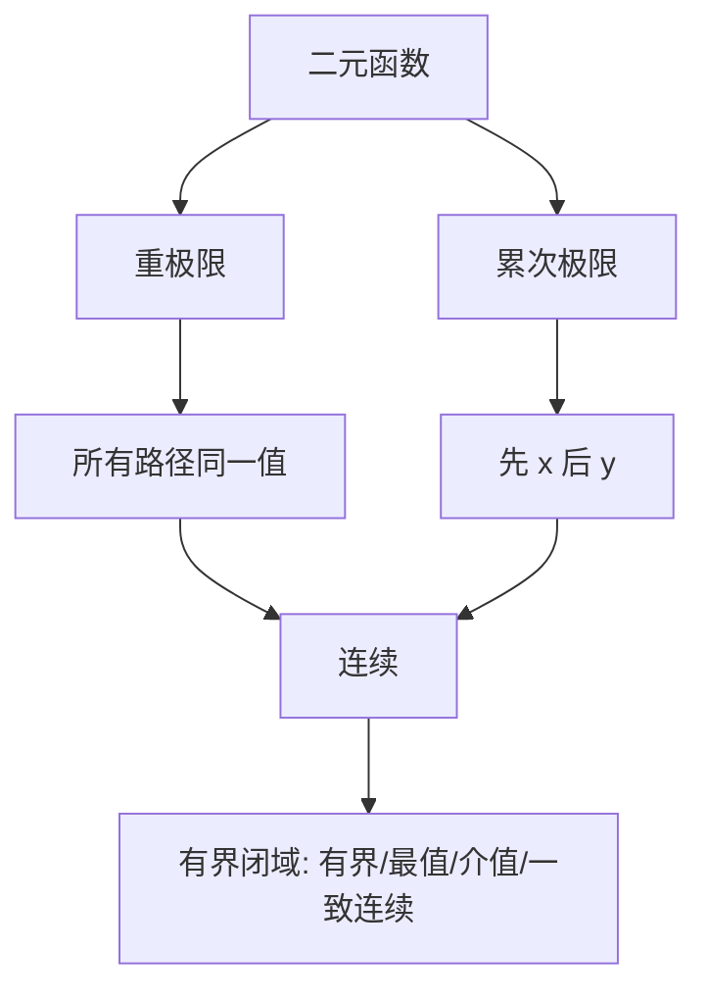

# 第 16 章：多元函数的极限与连续

- **难度**：★★★ | **预估学时**：3 小时 | **前置**：第 3、4 章极限与连续

## 学习目标

学完本章，你能：

1. 说明平面点集的内点、聚点、开集、闭集、有界闭集各自含义。
2. 写出二元函数重极限的定义，并说明它与累次极限的区别。
3. 判断二元函数的连续性，复述有界闭域上连续函数的性质。

## 一句话核心

多元极限的难点不在公式，在"怎么趋近"：一元只有左右两条路，二元有无数条，必须所有路径都给出同一极限。

## 零基础讲解

### 概念 1：平面点集的基本概念（难度：基础）

设 $E\subset\mathbb{R}^2$，$P_0$ 是平面上一点。

- **内点**：存在 $P_0$ 的邻域完全含于 $E$。
- **外点**：存在邻域完全不含于 $E$。
- **边界点**：任意邻域既含 $E$ 的点，又含不在 $E$ 的点。
- **聚点**：任意去心邻域含 $E$ 中至少一个点（可以不属于 $E$）。
- **开集**：每点都是内点。**闭集**：补集是开集，等价于包含所有聚点。
- **连通集**：任意两点可用折线连在集合内。
- **区域**：连通的开集；**闭区域**：区域加边界。

这些概念是为后面的"有界闭域上连续函数性质"做准备：只有闭且有界，才能保证取到最值。

### 概念 2：二重极限（难度：高难）

设 $f$ 在 $P_0$ 的某去心邻域有定义。若对任意 $\varepsilon&gt;0$，存在 $\delta&gt;0$，使当 $0&lt;\sqrt{(x-x_0)^2+(y-y_0)^2}&lt;\delta$ 时都有

$$|f(x,y)-A|&lt;\varepsilon,$$

则称 $P\to P_0$ 时 $f$ 的极限为 $A$，记 $\lim_{(x,y)\to(x_0,y_0)}f(x,y)=A$。

与一元的区别在"$0&lt;\rho&lt;\delta$"里的 $\rho$ 是距离，要求以任何方式靠近都以 $A$ 为极限。这比一元严格得多。

**判断不存在的方法**：找两条路径给出不同极限。经典例子

$$\lim_{(x,y)\to(0,0)}\frac{xy}{x^2+y^2}$$

沿 $y=kx$ 趋近得 $\frac{k}{1+k^2}$，随 $k$ 变化，所以极限不存在。

**极坐标法**：若 $f(r\cos\theta,r\sin\theta)$ 对 $\theta$ 一致地趋于 $A$（即与 $\theta$ 无关），则极限存在。这条常用于证明存在。

### 概念 3：累次极限（难度：进阶）

先对 $x$ 取极限再对 $y$ 取极限，叫累次极限：

$$\lim_{y\to y_0}\lim_{x\to x_0}f(x,y).$$

累次极限与重极限是两回事。重极限存在可以推出两个累次极限存在且相等（在函数定义良好的前提下）；反过来不成立。$\frac{xy}{x^2+y^2}$ 的两个累次极限都是 0，但重极限不存在，这就是反例。

顺序也不能交换：有些函数两个累次极限都存在但不相等。

### 概念 4：连续性与有界闭域上的性质（难度：进阶）

$f$ 在 $P_0$ 连续指 $\lim_{P\to P_0}f(P)=f(P_0)$。

多元连续函数的四则运算、复合仍连续；初等函数在其定义域内连续。

**有界闭域上的连续函数**（与一元闭区间对应）：

- 有界。
- 取到最大值与最小值。
- 介值性：连通闭域上，任意两点的函数值之间都能被某点取到。
- 一致连续：对距离小于 $\delta$ 的任意两点，函数值差小于 $\varepsilon$。

证明都回到致密性定理：有界闭域上的点列必有收敛子列，且极限点仍在域内（闭性）。

## 图示

看图说明：两条极限路最后汇到连续。右侧的 G 是目的：把一元的闭区间四定理整体搬过来。

## 类比与实例

- 类比：重极限像从四面八方走进一个广场中心，不管从哪条路走，最后看到的东西必须一样；累次极限像先南北走再东西走，路线固定。失效边界：路线固定得到的结果不能代表所有路线。
- 实例：判断 $\lim_{(x,y)\to(0,0)}\frac{x^2y}{x^2+y^2}$。用极坐标，$|f|\le r$，$r\to0$，所以极限为 0。这个函数沿所有路径都趋于 0。

## 常见误解

- 别以为"两个累次极限相等就有重极限"——$\frac{xy}{x^2+y^2}$ 是反例。
- 别以为"沿所有直线趋近就够"——还要考虑抛物线等曲线路径。
- 别以为"开区域上连续函数也有最值"——必须闭且有界。
- 别以为"偏导存在就连续"——偏导只沿两个方向，不能保证所有方向。

## 自测题（答案）

1. 单选：$\lim_{(x,y)\to(0,0)}\frac{xy}{x^2+y^2}$ 的结果是（ ）
   - A. 0　B. 1　C. 不存在　D. 无穷

   **答案**：C。解析：沿 $y=kx$ 得 $\frac{k}{1+k^2}$，随 $k$ 变。

2. 填空：$\lim_{(x,y)\to(0,0)}\frac{x^2y}{x^2+y^2}=$（ ）。

   **答案**：0。解析：极坐标下 $|f|\le r\to0$。

3. 简答：为什么有界闭域上的连续函数一定取到最值？

   **答案**：取上确界 $M$，构造点列使函数值趋于 $M$；有界闭域保证点列有收敛子列且极限点在域内，连续性保证该点函数值为 $M$。

## 复习锚点

- 重极限要求所有路径同一值，累次极限只是其中一条。
- 证明不存在找两条路径，证明存在用极坐标或不等式放缩。
- 有界闭域四性质是一元闭区间四定理的平移。
