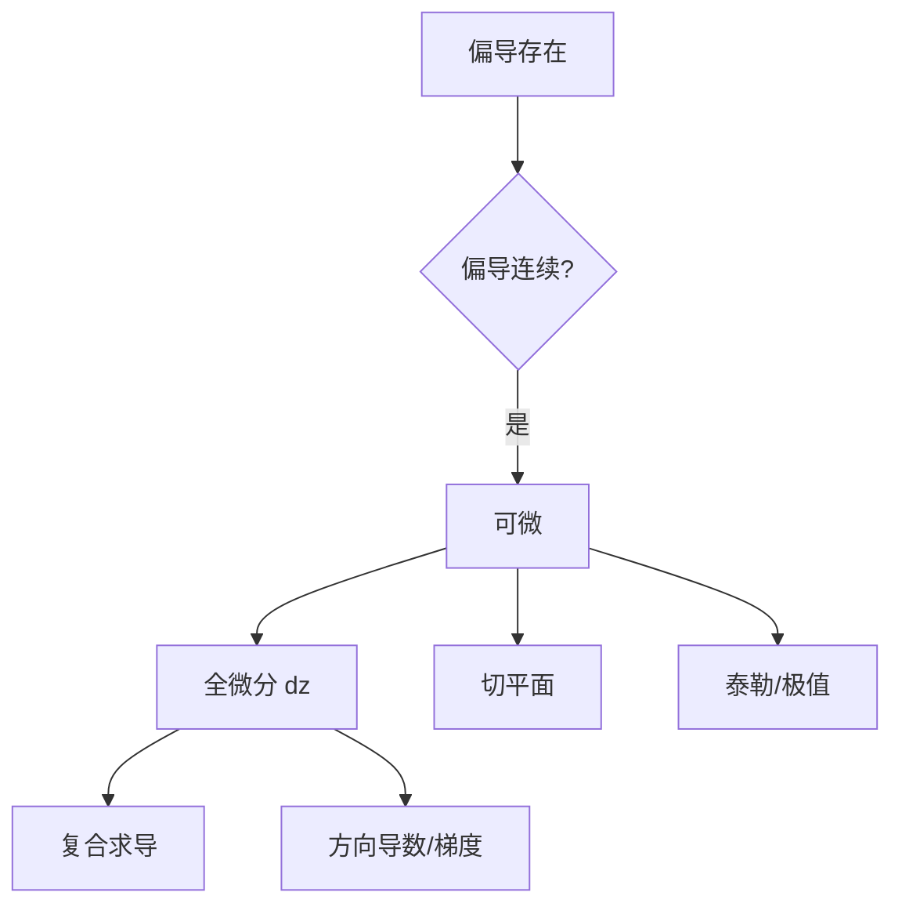

# 第 17 章：多元函数微分学

- **难度**：★★★ | **预估学时**：4 小时 | **前置**：第 16 章多元极限、第 5 章导数

## 学习目标

学完本章，你能：

1. 写出可微的定义，说明偏导存在与可微的关系。
2. 用复合函数求导法则（链式法则）计算多元复合函数的偏导。
3. 求方向导数与梯度，写出多元泰勒公式并求无条件极值。

## 一句话核心

多元里"可微"比"偏导存在"强得多：可微要求函数在一点附近能被一个线性函数整体逼近，不只是沿两条坐标轴有变化率。

## 零基础讲解

### 概念 1：偏导数与全微分（难度：高难）

偏导数是"只动一个变量"的导数：

$$f_x(x_0,y_0)=\lim_{\Delta x\to0}\frac{f(x_0+\Delta x,y_0)-f(x_0,y_0)}{\Delta x}.$$

**可微**的定义：若存在常数 $A,B$，使

$$\Delta z=f(x_0+\Delta x,y_0+\Delta y)-f(x_0,y_0)=A\Delta x+B\Delta y+o(\rho),$$

其中 $\rho=\sqrt{\Delta x^2+\Delta y^2}$，则称 $f$ 在 $(x_0,y_0)$ 可微。此时 $A=f_x$，$B=f_y$，全微分

$$dz=f_xdx+f_ydy.$$

**可微的充分条件**：偏导存在且连续。注意顺序：偏导存在不一定可微；可微一定偏导存在。

反例：$f(x,y)=\frac{xy}{x^2+y^2}$（原点补 0）。原点偏导都为 0，但函数在原点不连续，更不可微。

几何意义：可微意味着曲面在一点附近有切平面，且曲面与切平面的差距是高阶小量。

### 概念 2：复合函数求导（难度：进阶）

设 $z=f(u,v)$，$u=u(x,y)$，$v=v(x,y)$，则

$$\frac{\partial z}{\partial x}=f_u\frac{\partial u}{\partial x}+f_v\frac{\partial v}{\partial x}.$$

这就是链式法则：把每条路径的导数相乘再相加。画一张"变量依赖树"，有几个中间变量就加几项，可以避免漏项。

一阶微分的形式不变性在多元里同样成立：$dz=f_udu+f_vdv$，不管 $u,v$ 是自变量还是中间变量。

二阶偏导要小心：$\frac{\partial^2z}{\partial x\partial y}$ 求完一次后再对另一个变量求，中间变量也要再链式一次，容易漏项。

### 概念 3：方向导数与梯度（难度：进阶）

沿单位向量 $\mathbf l=(\cos\alpha,\cos\beta)$ 的方向导数

$$\frac{\partial f}{\partial l}=f_x\cos\alpha+f_y\cos\beta.$$

**梯度** $\nabla f=(f_x,f_y)$，性质：

- 方向导数等于梯度与方向向量的内积：$\frac{\partial f}{\partial l}=\nabla f\cdot\mathbf l$。
- 梯度方向是函数增长最快的方向，梯度模是最大变化率。
- 梯度垂直于等值线。

例：$f(x,y)=x^2+y^2$ 在 $(1,1)$ 处，$\nabla f=(2,2)$，沿 $(1,1)/\sqrt2$ 的方向导数为 $2\sqrt2$，是最大增长率。

### 概念 4：高阶偏导与泰勒公式（难度：进阶）

混合偏导在连续时与求导顺序无关：$f_{xy}=f_{yx}$。

**多元泰勒公式**（到二阶）：

$$f(x_0+h,y_0+k)=f+f_xh+f_yk+\frac12\left(f_{xx}h^2+2f_{xy}hk+f_{yy}k^2\right)+o(\rho^2).$$

二次项由黑塞矩阵 $H=\begin{pmatrix}f_{xx}&f_{xy}\\f_{xy}&f_{yy}\end{pmatrix}$ 给出。

**无条件极值**：

- 必要条件：$\nabla f=0$（驻点）。
- 充分条件：看黑塞矩阵。$f_{xx}>0$ 且行列式 $>0$ 为极小；$f_{xx}<0$ 且行列式 $>0$ 为极大；行列式 $<0$ 为鞍点；行列式 $=0$ 需另判。

例：$f=x^2+y^2$ 在原点，$H=\begin{pmatrix}2&0\\0&2\end{pmatrix}$，正定，极小值 0。

## 图示

看图说明：偏导连续是可微的充分条件，不是必要条件；可微之后才分出四条应用路。判断极值必须走 H 那一支。

## 类比与实例

- 类比：全微分像给曲面贴一块小平板，贴得越好（误差越高阶小），越接近可微。偏导只是沿两个方向的坡度，单独知道两个坡度不能保证整块曲面是平的。失效边界：可微要求"整体"逼近，不只是两条线。
- 实例：$z=e^{xy}\sin(x+y)$，求 $z_x$。链式：$z_x=e^{xy}\sin(x+y)\cdot y+e^{xy}\cos(x+y)\cdot1$。两项分别来自指数与三角。

## 常见误解

- 别以为"偏导存在就可微"——反例是 $\frac{xy}{x^2+y^2}$。
- 别以为"梯度是方向导数的最大值"——梯度是向量，模才是最大变化率。
- 别以为"驻点一定是极值点"——鞍点也满足 $\nabla f=0$。
- 别以为"混合偏导总能交换顺序"——需要二阶偏导连续。

## 自测题（答案）

1. 单选：$f(x,y)=\frac{xy}{x^2+y^2}$（原点补 0）在原点（ ）
   - A. 可微　B. 偏导存在但不连续　C. 连续但不可微　D. 偏导不存在

   **答案**：B。解析：沿坐标轴偏导都为 0，但沿 $y=x$ 极限为 $\frac12$，不连续。

2. 填空：$f=x^2+y^2$ 在 $(1,1)$ 处的梯度是（ ）。

   **答案**：$(2,2)$。解析：$f_x=2x$，$f_y=2y$，代入。

3. 简答：如何用黑塞矩阵判断驻点类型？

   **答案**：算 $f_{xx}$ 与行列式 $D=f_{xx}f_{yy}-f_{xy}^2$。$D>0$ 且 $f_{xx}>0$ 为极小，$D>0$ 且 $f_{xx}<0$ 为极大，$D<0$ 为鞍点，$D=0$ 需另判。

## 复习锚点

- 可微 = 线性逼近 + 高阶误差，强于偏导存在。
- 链式法则画依赖树，几条路径就几项。
- 梯度指向最陡上升方向，模是最大变化率。
