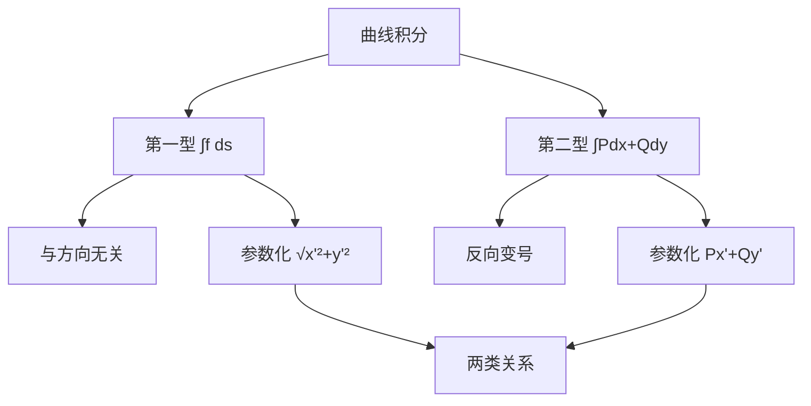

# 第 20 章：曲线积分

- **难度**：★★☆ | **预估学时**：3 小时 | **前置**：第 9 章定积分、第 17 章微分

## 学习目标

学完本章，你能：

1. 区分第一型（对弧长）与第二型（对坐标）曲线积分，写出各自定义。
2. 把两类曲线积分化成定积分计算。
3. 写出两类积分之间的关系式。

## 一句话核心

第一型积分只跟曲线形状有关，第二型积分还跟方向有关。两者的区别在"切的是弧长还是坐标增量"。

## 零基础讲解

### 概念 1：第一型曲线积分（难度：基础）

设 $L$ 是平面曲线，$f$ 在 $L$ 上有界。把 $L$ 分成小段，每段长 $\Delta s_i$，取点 $(\xi_i,\eta_i)$，作和 $\sum f(\xi_i,\eta_i)\Delta s_i$，极限存在则记为

$$\int_L f(x,y)\,ds.$$

性质：与方向无关（$\int_{L^-}f\,ds=\int_L f\,ds$），可以相加合并，几何上求质量（$f$ 是线密度）或弧长（$f=1$）。

**计算**：设 $L$ 由参数 $x=x(t)$、$y=y(t)$（$\alpha\le t\le\beta$）给出，则

$$\int_L f\,ds=\int_\alpha^\beta f(x(t),y(t))\sqrt{x'^2+y'^2}\,dt.$$

直角坐标 $y=y(x)$ 时，$\sqrt{1+y'^2}dx$；极坐标 $r=r(\theta)$ 时，$\sqrt{r^2+r'^2}d\theta$。

### 概念 2：第二型曲线积分（难度：进阶）

$$\int_L P(x,y)dx+Q(x,y)dy=\lim\sum\left[P(\xi_i,\eta_i)\Delta x_i+Q(\xi_i,\eta_i)\Delta y_i\right].$$

关键差别是**方向**：反向走一遍，积分变号。

**计算**：参数化后代入

$$\int_L P\,dx+Q\,dy=\int_\alpha^\beta\left[P(x(t),y(t))x'(t)+Q(x(t),y(t))y'(t)\right]dt.$$

这里 $\alpha$ 对应起点、$\beta$ 对应终点，方向由参数增大方向决定。若曲线方向与参数方向相反，要加负号。

物理意义：力 $\mathbf F=(P,Q)$ 沿曲线做的功。

例：$L$ 为从 $(0,0)$ 到 $(1,1)$ 的直线 $y=x$，算 $\int_L x\,dy+y\,dx$。参数化 $x=t$、$y=t$，$t:0\to1$，积分 $=\int_0^1(t+t)dt=1$。

### 概念 3：两类积分的联系（难度：进阶）

设曲线在点处的切向量方向余弦为 $\cos\alpha$、$\cos\beta$，则

$$\int_L P\,dx+Q\,dy=\int_L(P\cos\alpha+Q\cos\beta)\,ds.$$

这条式子说明：第二型积分是第一型积分在切向量上的投影。反过来，若已知曲线方向，可以把 $dx=\cos\alpha\,ds$、$dy=\cos\beta\,ds$ 代进去，把第二型化第一型。

闭曲线积分常记 $\oint_L$，默认取逆时针（正向）：沿曲线走时区域在左侧。

## 图示

看图说明：两条计算路线最后汇到关系式。做题先判类型：题目说"弧长、质量"走左边，说"做功、流量"走右边。

## 类比与实例

- 类比：第一型像沿路撒豆子，豆子密度只跟位置有关，走哪边撒都一样；第二型像沿路推车，推的方向反了，做的功就变号。失效边界：第二型必须给出起点终点，否则符号定不下来。
- 实例：$L$ 为上半圆 $x^2+y^2=1$（$y\ge0$），从 $(1,0)$ 到 $(-1,0)$，算 $\int_L y\,dx$。参数 $x=\cos t$、$y=\sin t$，$t:0\to\pi$，$dx=-\sin t\,dt$，积分 $=\int_0^\pi\sin t(-\sin t)dt=-\frac\pi2$。

## 常见误解

- 别以为"两类积分可以随便互换"——差一个切向量投影，方向也影响符号。
- 别以为"第二型积分只跟端点有关"——一般与路径有关，只有保守场才只看端点。
- 别以为"闭曲线积分一定是零"——$\oint$ 一般不为零，格林公式会给出它与区域的关系。
- 别以为"参数范围可以随便写"——必须与曲线方向一致。

## 自测题（答案）

1. 单选：第一型曲线积分 $\int_L f\,ds$ 与方向的关系是（ ）
   - A. 反向变号　B. 无关　C. 反向加倍　D. 只与起点有关

   **答案**：B。解析：$\Delta s$ 恒为正，与行走方向无关。

2. 填空：$\int_L x\,dy+y\,dx$ 沿 $y=x$ 从 $(0,0)$ 到 $(1,1)$ 等于（ ）。

   **答案**：1。解析：参数化后 $\int_0^1 2t\,dt=1$。

3. 简答：写出两类曲线积分的关系式。

   **答案**：$\int_L P\,dx+Q\,dy=\int_L(P\cos\alpha+Q\cos\beta)ds$，其中 $\cos\alpha,\cos\beta$ 是有向曲线的切向量方向余弦。

## 复习锚点

- 第一型对弧长，无方向；第二型对坐标，有方向。
- 计算都靠参数化，区别在乘 $ds$ 还是 $dx,dy$。
- 关系式是切向量投影。
