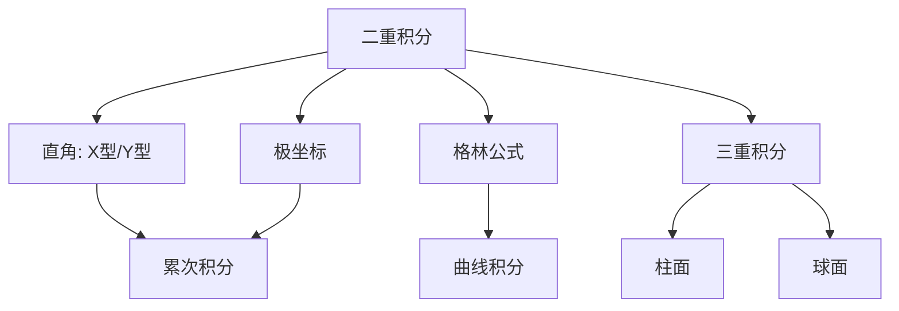

# 第 21 章：重积分

- **难度**：★★★ | **预估学时**：5 小时 | **前置**：第 9 章定积分、第 18 章坐标变换、第 20 章曲线积分

## 学习目标

学完本章，你能：

1. 用定义与达布和说明二重积分的存在性，写出性质。
2. 在直角坐标与极坐标下把二重积分化成累次积分。
3. 用格林公式把闭曲线积分化成二重积分，判断路径无关。
4. 用柱面、球面坐标算三重积分，求曲面面积、质心、转动惯量。

## 一句话核心

重积分是把一元的分割求和推广到平面与空间：面积元从 $dx$ 变成 $d\sigma$，换坐标时要乘雅可比行列式。

## 零基础讲解

### 概念 1：二重积分的定义与性质（难度：高难）

设 $D$ 是平面有界闭区域，$f$ 在 $D$ 上有界。把 $D$ 分成小区域 $\Delta\sigma_i$，取点 $(\xi_i,\eta_i)$，作和 $\sum f(\xi_i,\eta_i)\Delta\sigma_i$。若细度趋于 0 时极限存在且与分割取点无关，记为

$$\iint_D f(x,y)\,d\sigma.$$

可积的充要条件仍是达布和之差趋于 0（把区间换成区域）。连续函数在闭区域上可积。

性质与一元对应：线性、区域可加、保号、估值、中值定理（连续时存在 $(\xi,\eta)$ 使积分等于 $f(\xi,\eta)\cdot$ 面积）。

几何意义：$f\ge0$ 时是曲顶柱体的体积；$f=1$ 时是区域面积。

### 概念 2：直角坐标计算（难度：基础）

**X 型区域**：$a\le x\le b$，$\varphi_1(x)\le y\le\varphi_2(x)$，则

$$\iint_D f\,d\sigma=\int_a^b\left(\int_{\varphi_1(x)}^{\varphi_2(x)}f(x,y)dy\right)dx.$$

**Y 型区域**：$c\le y\le d$，$\psi_1(y)\le x\le\psi_2(y)$，则先对 $x$ 后对 $y$。

一般区域要拆成若干 X 型或 Y 型。选序原则：哪个方向先积更容易，就先积哪个。内层积分把另一个变量当常数。

例：$\iint_D xy\,d\sigma$，$D$ 由 $y=x$、$y=x^2$ 围成（$0\le x\le1$）。先对 $y$：$\int_0^1x\left(\int_{x^2}^{x}y\,dy\right)dx=\int_0^1x\cdot\frac{x^2-x^4}{2}dx=\frac{1}{24}$。

### 概念 3：格林公式与路径无关（难度：高难）

设 $L$ 是区域 $D$ 的正向边界（逆时针），$P,Q$ 有连续偏导，则

$$\oint_L P\,dx+Q\,dy=\iint_D\left(\frac{\partial Q}{\partial x}-\frac{\partial P}{\partial y}\right)d\sigma.$$

这是联系曲线积分与二重积分的桥。用法有两种：把难算的曲线积分化成二重积分；或者反过来，把二重积分化成曲线积分（当被积函数恰好是 $\frac{\partial Q}{\partial x}-\frac{\partial P}{\partial y}$ 时）。

**路径无关的条件**：在单连通区域上，$\frac{\partial Q}{\partial x}=\frac{\partial P}{\partial y}$ 时，曲线积分只与起点终点有关，且存在势函数 $u$ 使 $du=Pdx+Qdy$。

例：$\oint_L(x^2-y)dx+(x+y^2)dy$，$L$ 为单位圆正向。$\frac{\partial Q}{\partial x}=1$，$\frac{\partial P}{\partial y}=-1$，差为 2，积分 $=2\pi$。

### 概念 4：变量变换与极坐标（难度：进阶）

作变换 $x=x(u,v)$、$y=y(u,v)$，则

$$\iint_D f(x,y)dxdy=\iint_{D'}f(x(u,v),y(u,v))\left|\frac{\partial(x,y)}{\partial(u,v)}\right|dudv.$$

**极坐标**：$x=r\cos\theta$，$y=r\sin\theta$，雅可比为 $r$，所以

$$\iint_D f\,dxdy=\iint_{D'}f(r\cos\theta,r\sin\theta)\,r\,drd\theta.$$

$r$ 不能漏。极坐标适合圆形、扇形、环形的区域，或被积函数含 $x^2+y^2$ 的场合。

例：$\iint_D e^{-(x^2+y^2)}dxdy$，$D$ 为单位圆，得 $\int_0^{2\pi}\int_0^1e^{-r^2}r\,drd\theta=\pi(1-e^{-1})$。

### 概念 5：三重积分（难度：进阶）

$$\iiint_\Omega f\,dV.$$

**柱面坐标**：$x=r\cos\theta$、$y=r\sin\theta$、$z=z$，雅可比 $r$。

**球面坐标**：$x=\rho\sin\varphi\cos\theta$、$y=\rho\sin\varphi\sin\theta$、$z=\rho\cos\varphi$，雅可比 $\rho^2\sin\varphi$。注意 $\varphi$ 是极角（与 $z$ 轴夹角），$\theta$ 是方位角。

例：$\iiint_\Omega z\,dV$，$\Omega$ 为单位上半球，$\int_0^{2\pi}\int_0^{\pi/2}\int_0^1\rho\cos\varphi\cdot\rho^2\sin\varphi\,d\rho d\varphi d\theta=\frac\pi4$。

### 概念 6：应用与推广（难度：进阶）

- **曲面面积**：$A=\iint_D\sqrt{1+z_x^2+z_y^2}\,d\sigma$。
- **质心**：$\bar x=\frac{1}{M}\iint x\rho\,d\sigma$，$M=\iint\rho\,d\sigma$。
- **转动惯量**：$I_z=\iint(x^2+y^2)\rho\,d\sigma$。
- **n 重积分**：同一套分割求和定义，$n$ 维体积元换 $dx_1\cdots dx_n$。
- **反常二重积分**：无界区域或无界函数，用极限定义。$\iint_{\mathbb{R}^2}e^{-(x^2+y^2)}d\sigma=\pi$ 是标准结论。

## 图示

看图说明：左侧三条是二重积分的算法，D 是它与曲线积分的桥。G 往右是升维，两种坐标的雅可比不同。

## 类比与实例

- 类比：重积分像给一块地铺瓷砖，先算每一竖条里有多少，再把竖条加起来。换坐标就是换一种切法，切法不同，每块的面积换算系数不同。失效边界：区域必须能切成规则条，否则要先分割。
- 实例：算 $\iint_D(x^2+y^2)d\sigma$，$D$ 为 $x^2+y^2\le1$。用极坐标，$\int_0^{2\pi}\int_0^1r^2\cdot r\,drd\theta=2\pi\cdot\frac14=\frac\pi2$。

## 常见误解

- 别以为"累次积分顺序可以随便换"——换序要重写积分限，不定式区域可能出错。
- 别以为"极坐标雅可比是 1"——是 $r$，漏掉就全错。
- 别以为"格林公式对任何闭曲线都成立"——要求 $P,Q$ 在 $D$ 上有连续偏导，区域不能有洞。
- 别以为"球面坐标雅可比是 $\rho^2$"——是 $\rho^2\sin\varphi$。

## 自测题（答案）

1. 单选：极坐标下 $dxdy$ 等于（ ）
   - A. $drd\theta$　B. $r\,drd\theta$　C. $r^2drd\theta$　D. $\frac1r drd\theta$

   **答案**：B。解析：雅可比行列式为 $r$。

2. 填空：$\oint_L(x^2-y)dx+(x+y^2)dy$ 沿单位圆正向等于（ ）。

   **答案**：$2\pi$。解析：$Q_x-P_y=1-(-1)=2$，乘以面积 $\pi$。

3. 简答：球面坐标的雅可比为什么是 $\rho^2\sin\varphi$？

   **答案**：$x_\rho,y_\rho,z_\rho$、$x_\varphi,\dots$ 的行列式算出来是 $\rho^2\sin\varphi$，它对应球面上一小块体积元的伸缩比例。

## 复习锚点

- 二重积分先定区域类型，再选积分次序。
- 格林公式 $\oint Pdx+Qdy=\iint(Q_x-P_y)d\sigma$，路径无关要求 $Q_x=P_y$。
- 三种坐标的雅可比：直角 1、极坐标 $r$、球坐标 $\rho^2\sin\varphi$。
