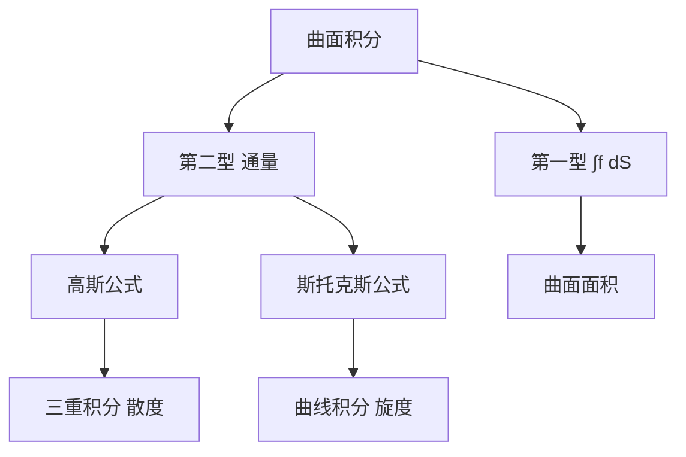

# 第 22 章：曲面积分

- **难度**：★★★ | **预估学时**：4 小时 | **前置**：第 20 章曲线积分、第 21 章重积分

## 学习目标

学完本章，你能：

1. 区分第一型与第二型曲面积分，说明"侧"的含义。
2. 把曲面积分化为二重积分计算。
3. 用高斯公式、斯托克斯公式把面积分与重积分、曲线积分互化。
4. 写出梯度、散度、旋度的定义与含义。

## 一句话核心

第一型曲面积分算"面上有多少"，第二型算"穿过面的通量"。第二型必须选侧，换侧变号。

## 零基础讲解

### 概念 1：第一型曲面积分（难度：基础）

设 $\Sigma$ 是曲面，$f$ 在其上有界。把小曲面片面积记为 $\Delta S_i$，取点作和，极限记为

$$\iint_\Sigma f(x,y,z)\,dS.$$

与侧无关。$f=1$ 时等于曲面面积，$f$ 为面密度时等于质量。

**计算**：若 $\Sigma$ 由 $z=z(x,y)$ 给出，投影到 $D_{xy}$，则

$$dS=\sqrt{1+z_x^2+z_y^2}\,dxdy,$$

$$\iint_\Sigma f\,dS=\iint_{D_{xy}}f(x,y,z(x,y))\sqrt{1+z_x^2+z_y^2}\,dxdy.$$

### 概念 2：第二型曲面积分与侧（难度：高难）

曲面有两侧，用法向量定向。若 $\Sigma$ 由 $z=z(x,y)$ 给出，上侧法向量 $(-z_x,-z_y,1)$，下侧取反。

$$\iint_\Sigma P\,dydz+Q\,dzdx+R\,dxdy.$$

三项分别是向量场 $\mathbf F=(P,Q,R)$ 与有向面积元的内积分量。物理上是通量：单位时间穿过曲面的量。

**计算**：投影到坐标面，注意符号：

$$\iint_\Sigma R\,dxdy=\pm\iint_{D_{xy}}R(x,y,z(x,y))dxdy,$$

上侧取正、下侧取负。$P$ 项投影到 $yz$ 面，$Q$ 项投影到 $zx$ 面，符号按侧判断。

### 概念 3：两类曲面积分的联系（难度：进阶）

设曲面单位法向量为 $(\cos\alpha,\cos\beta,\cos\gamma)$，则

$$\iint_\Sigma P\,dydz+Q\,dzdx+R\,dxdy=\iint_\Sigma(P\cos\alpha+Q\cos\beta+R\cos\gamma)\,dS.$$

这就是通量的"投影写法"：第二型等于第一型乘法向量的方向余弦。

### 概念 4：高斯公式（难度：高难）

设 $\Omega$ 是空间闭区域，$\Sigma$ 是其边界曲面取外侧，$P,Q,R$ 有连续偏导，则

$$\oiint_\Sigma P\,dydz+Q\,dzdx+R\,dxdy=\iiint_\Omega\left(\frac{\partial P}{\partial x}+\frac{\partial Q}{\partial y}+\frac{\partial R}{\partial z}\right)dV.$$

右边括号是散度 $\nabla\cdot\mathbf F$。高斯公式是格林公式在三维的推广，把闭曲面通量换成体内散度的积分。

用法：曲面不闭合时，补一块面使其闭合，算完再减去补的部分。

例：$\mathbf F=(x,y,z)$，$\Sigma$ 为单位球面外侧，通量 $=\iiint(1+1+1)dV=3\cdot\frac{4\pi}{3}=4\pi$。

### 概念 5：斯托克斯公式（难度：进阶）

$$\oint_\Gamma P\,dx+Q\,dy+R\,dz=\iint_\Sigma\left(\frac{\partial R}{\partial y}-\frac{\partial Q}{\partial z}\right)dydz+\cdots$$

三项循环对称，右边是旋度 $\nabla\times\mathbf F$ 与有向面积元的内积。它把空间闭曲线积分换成以该曲线为边界的曲面上的积分。

方向约定：沿 $\Gamma$ 行走时，曲面在左侧，法向量与行走方向成右手系。

### 概念 6：场论初步（难度：进阶）

- **梯度**：$\mathrm{grad}\,u=(u_x,u_y,u_z)$，标量场变化最快的方向。
- **散度**：$\mathrm{div}\,\mathbf F=P_x+Q_y+R_z$，描述"源"的强度，正为源、负为汇。
- **旋度**：$\mathrm{curl}\,\mathbf F=(R_y-Q_z,\ P_z-R_x,\ Q_x-P_y)$，描述旋转趋势。
- **管量场**：散度为零的场，通过任意闭曲面通量为零，流管中通量守恒。

恒等式：$\mathrm{div}(\mathrm{curl}\,\mathbf F)=0$，$\mathrm{curl}(\mathrm{grad}\,u)=\mathbf 0$。

## 图示

看图说明：C 是枢纽，两条大定理都从它出发。D 通向体积分，E 通向边界曲线，正好是"升一维"与"降一维"两个方向。

## 类比与实例

- 类比：第二型曲面积分像统计穿过一张网的水流。网的方向（侧）决定流量正负，换一面朝向来数就变号。失效边界：网必须能定向，莫比乌斯带这类曲面不行。
- 实例：$\Sigma$ 为平面 $z=1$ 上 $x^2+y^2\le1$ 的上侧，算 $\iint_\Sigma z\,dxdy$。上侧取正，投影为单位圆，积分 $=\iint_{D}1\,dxdy=\pi$。

## 常见误解

- 别以为"第二型曲面积分与侧无关"——换侧变号。
- 别以为"高斯公式对开曲面也直接用"——必须闭曲面，否则要补面。
- 别以为"斯托克斯公式的方向可以随便取"——右手系约定必须遵守。
- 别以为"散度是向量"——散度是标量，旋度才是向量。

## 自测题（答案）

1. 单选：高斯公式把闭曲面积分化为（ ）
   - A. 曲线积分　B. 三重积分　C. 二重积分　D. 第一型曲面积分

   **答案**：B。解析：高斯公式的右端是散度在体积上的三重积分。

2. 填空：$\mathbf F=(x,y,z)$ 的散度是（ ）。

   **答案**：3。解析：$P_x+Q_y+R_z=1+1+1$。

3. 简答：为什么第二型曲面积分必须指定侧？

   **答案**：通量有方向，法向量取反后每一项都变号；不指定侧，积分值没有确定含义。

## 复习锚点

- 第一型无侧，第二型有侧且换侧变号。
- 两类关系靠法向量方向余弦。
- 高斯对闭曲面，斯托克斯对边界曲线，右手系定向。
