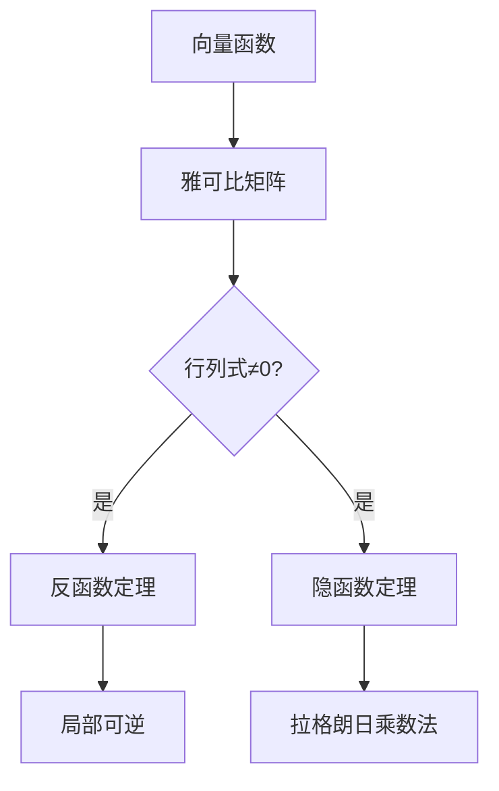

# 第 23 章：向量函数微分学

- **难度**：★★★ | **预估学时**：3.5 小时 | **前置**：第 17、18 章多元微分

## 学习目标

学完本章，你能：

1. 写出 $n$ 维欧氏空间的范数与邻域，说明向量函数极限与连续的定义。
2. 写出向量函数可微的定义，用雅可比矩阵表示导数。
3. 复述反函数定理与隐函数定理，用它们推出拉格朗日乘数法。

## 一句话核心

向量函数就是把多个分量打包成一个映射，它的导数是一个矩阵；矩阵可逆时，映射在局部可逆。

## 零基础讲解

### 概念 1：n 维欧氏空间与向量函数（难度：基础）

$\mathbb{R}^n$ 中的点记 $\mathbf x=(x_1,\dots,x_n)$，范数

$$\|\mathbf x\|=\sqrt{x_1^2+\cdots+x_n^2}.$$

邻域、内点、开集、闭集、连通、有界等概念与二维情形逐字照搬，只把距离换成上面的范数。

向量函数 $\mathbf f:D\subset\mathbb{R}^n\to\mathbb{R}^m$ 写成

$$\mathbf f(\mathbf x)=(f_1(\mathbf x),\dots,f_m(\mathbf x)).$$

极限按分量定义：每个分量都收敛才叫收敛。连续同样按分量判断。因此，向量函数的极限与连续可以逐分量处理。

### 概念 2：向量函数的微分（难度：高难）

若存在 $m\times n$ 矩阵 $A$，使

$$\mathbf f(\mathbf x_0+\mathbf h)-\mathbf f(\mathbf x_0)=A\mathbf h+o(\|\mathbf h\|),$$

则称 $\mathbf f$ 在 $\mathbf x_0$ 可微，$A$ 叫雅可比矩阵，记 $J_f$，元素为 $\frac{\partial f_i}{\partial x_j}$。

这与一元导数 $f'(x_0)$ 的定义同构：一元时矩阵退化为一个数。可微的充分条件仍是偏导连续。

**链式法则**：$\mathbf f\circ\mathbf g$ 的雅可比等于两个雅可比矩阵的乘积 $J_fJ_g$。矩阵乘法不可交换，顺序不能反。

**中值不等式**：$\|\mathbf f(\mathbf b)-\mathbf f(\mathbf a)\|\le\sup\|\mathbf f'(\mathbf x)\|\cdot\|\mathbf b-\mathbf a\|$。向量函数没有等式的 seguridad中值定理，只有不等式，因为各分量的中值点可能不同。

**黑塞矩阵与极值**：标量函数 $u(\mathbf x)$ 的二阶导构成对称矩阵 $H$。驻点处 $H$ 正定为极小，负定为极大，不定为鞍点。

### 概念 3：反函数定理（难度：高难）

设 $\mathbf f$ 在 $\mathbf x_0$ 的邻域内连续可微，且 $J_f(\mathbf x_0)$ 可逆（行列式非零），则存在 $\mathbf x_0$ 与 $\mathbf f(\mathbf x_0)$ 的邻域，使 $\mathbf f$ 在其上是一一映射，逆映射也连续可微，且

$$J_{f^{-1}}(\mathbf y_0)=[J_f(\mathbf x_0)]^{-1}.$$

这条定理说明：局部可逆的判据就是雅可比行列式不为零，与一元 $f'(x_0)\ne0$ 完全对应。

### 概念 4：隐函数定理（难度：高难）

设 $\mathbf F(\mathbf x,\mathbf y)=\mathbf 0$，$\mathbf x\in\mathbb{R}^n$、$\mathbf y\in\mathbb{R}^m$。若 $\mathbf F(\mathbf x_0,\mathbf y_0)=0$ 且对 $\mathbf y$ 的雅可比矩阵 $\frac{\partial\mathbf F}{\partial\mathbf y}$ 在 $(\mathbf x_0,\mathbf y_0)$ 可逆，则存在唯一连续可微的 $\mathbf y=\mathbf g(\mathbf x)$ 满足方程，且

$$J_g=-\left[\frac{\partial\mathbf F}{\partial\mathbf y}\right]^{-1}\frac{\partial\mathbf F}{\partial\mathbf x}.$$

把它用在约束极值上：求 $f$ 在 $\mathbf g(\mathbf x)=0$ 下的极值，条件为 $\nabla f$ 与约束的梯度线性相关，即存在乘子 $\lambda$ 使 $\nabla f=\lambda\nabla g$。这就是拉格朗日乘数法的来源。

### 概念 5：向量函数的泰勒公式（难度：进阶）

$$\mathbf f(\mathbf x_0+\mathbf h)=\mathbf f(\mathbf x_0)+J_f(\mathbf x_0)\mathbf h+\frac12\mathbf h^TH\mathbf h+o(\|\mathbf h\|^2),$$

其中 $H$ 是各分量的黑塞矩阵（按分量分别写）。用它可以做二阶近似与极值判定。

## 图示

看图说明：整个第 23 章就围绕 B 与 C 两个节点展开。雅可比是"多元的导数"，行列式非零是"导数不为零"，结论自然对应。

## 类比与实例

- 类比：雅可比矩阵像一张"局部变形地图"，告诉你每个方向的输入变化如何分配到每个方向的输出变化。行列式非零说明这张地图没有把整个空间压扁。失效边界：只在一点附近成立，全局可逆还要额外条件。
- 实例：$\mathbf f(x,y)=(e^x\cos y,e^x\sin y)$，雅可比为 $e^x\begin{pmatrix}\cos y&-\sin y\\\sin y&\cos y\end{pmatrix}$，行列式 $e^{2x}\ne0$，所以处处局部可逆。这正是极坐标与复数的关系。

## 常见误解

- 别以为"偏导都存在就可微"——向量函数同样要求线性逼近整体成立。
- 别以为"雅可比行列式非零就全局可逆"——只保证局部。
- 别以为"向量函数有等式型中值定理"——只有中值不等式。
- 别以为"拉格朗日乘数法是新方法"——它就是隐函数定理的推论。

## 自测题（答案）

1. 单选：向量函数 $\mathbf f:\mathbb{R}^n\to\mathbb{R}^m$ 的雅可比矩阵形状是（ ）
   - A. $n\times n$　B. $m\times n$　C. $n\times m$　D. $m\times m$

   **答案**：B。解析：$m$ 个分量、$n$ 个自变量，矩阵为 $m$ 行 $n$ 列。

2. 填空：反函数定理要求雅可比矩阵（ ）。

   **答案**：可逆（行列式非零）。解析：这是局部一一对应的判据。

3. 简答：为什么向量函数只有中值不等式？

   **答案**：等式型中值定理要求存在同一点 $\xi$ 使各分量同时取到中值，各分量的中值点一般不同，所以只能给出范数不等式。

## 复习锚点

- 向量函数的导数是一个矩阵，链式法则是矩阵乘法。
- 雅可比行列式非零对应局部可逆。
- 反函数、隐函数、拉格朗日乘数法三者一条线。
