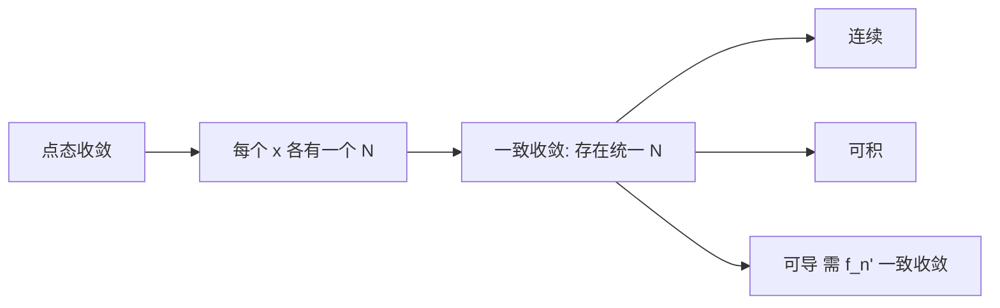

# 一致收敛（函数项级数）

- **难度**：高难 | **涉及章节**：第 13、14、19 章

## 一句话定义

部分和函数列在整段区间上共用一个 $N$：从第 $N$ 项起，所有 $x$ 处的误差都小于 $\varepsilon$。

## 为什么重要

它是一张通行证，允许把极限、积分、求导搬进求和号里。没有它，逐项积分与逐项求导都可能错。

## 图示

看图说明：从点态到一致，是量词顺序的调整，右侧三条是换来的性质。

## 详解

定义：对任意 $\varepsilon>0$，存在 $N$，使 $n>N$ 时对一切 $x\in D$ 都有 $|S_n(x)-S(x)|<\varepsilon$。

等价判据：$\sup_{x\in D}|S_n(x)-S(x)|\to0$。

$M$ 判别法：$|u_n(x)|\le M_n$ 且 $\sum M_n$ 收敛，则一致收敛。它是最常用的充分条件。

反例：$\sum\frac{x^n}{n}$ 在 $[0,1)$ 上点态收敛但不一致收敛。在 $x=1-1/n$ 处，项不趋于 0 的速度不够统一。

性质：一致收敛加连续得极限连续；加可积得积分可交换；加导数一致收敛得可求导。

## 常见误解

- 以为"每点收敛就一致收敛"。区间端点与边界层最容易失效。
- 以为"$M$ 判别法是必要条件"。不满足也可能一致收敛，只是要另找方法。
- 以为"逐项求导总可以"。需要导数列一致收敛。

## 在书中出现的脉络

| 章节 | 语境 | 关键结论 |
|---|---|---|
| 13 | 函数项级数 | 一致收敛定义与 M 判别法 |
| 14 | 幂级数 | 收敛区间内闭一致收敛 |
| 19 | 含参量积分 | 一致收敛换序 |

## 相关概念

- 前置：数列极限、函数列
- 后续：幂级数性质、含参量积分
