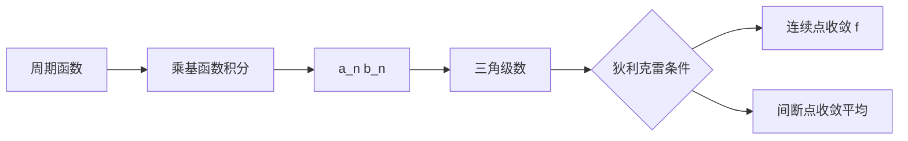

# 傅里叶级数

- **难度**：高难 | **涉及章节**：第 15 章

## 一句话定义

用相互正交的 sine 与 cos 叠加去逼近一个周期函数，系数由正交性积分算出。

## 为什么重要

它是"函数分解"的第一个实例，后面的小波、频谱分析都沿用同一套内积思路。工程里的信号处理直接以它为语言。

## 图示

看图说明：左边是系数提取，右边是收敛判定。系数只依赖内积，与函数的解析式无关。

## 详解

正交性：$\int_{-\pi}^{\pi}\cos nx\cos mx\,dx=0$（$n\ne m$），$\int\cos^2nx\,dx=\pi$。

系数：

$$a_n=\frac1\pi\int_{-\pi}^{\pi}f(x)\cos nx\,dx,\quad b_n=\frac1\pi\int_{-\pi}^{\pi}f(x)\sin nx\,dx,\quad a_0=\frac1\pi\int_{-\pi}^{\pi}f\,dx.$$

级数写成 $\frac{a_0}{2}+\sum(a_n\cos nx+b_n\sin nx)$。

收敛：狄利克雷条件下，连续点收敛到 $f(x)$，间断点收敛到左右极限平均，端点同样取平均。

奇偶性：奇函数只有正弦项，偶函数只有余弦项。

## 常见误解

- 以为级数处处等于 $f$。跳跃点差一个平均值。
- 以为 $a_0$ 是平均值。$a_0/2$ 才是。
- 以为奇函数展开没有常数项就够了。还要确认 $b_n$ 的计算区间对称。

## 在书中出现的脉络

| 章节 | 语境 | 关键结论 |
|---|---|---|
| 15 | 2π 周期 | 系数公式与收敛定理 |
| 15 | 2l 周期 | 换元后的系数 |
| 15 | 奇偶延拓 | 余弦级数与正弦级数 |

## 相关概念

- 前置：三角恒等式、定积分
- 后续：帕塞瓦尔等式、频谱分析
