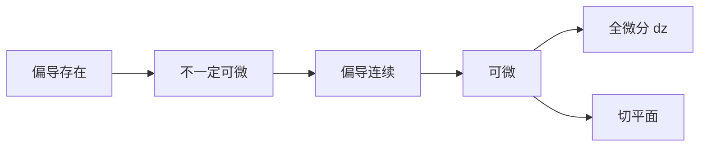

# 全微分与可微性

- **难度**：高难 | **涉及章节**：第 17、18、23 章

## 一句话定义

可微是"函数在一点附近能被一个线性函数整体逼近，误差比距离高一阶"；全微分就是那个线性函数。

## 为什么重要

多元里偏导存在太弱，可微才是真正的"光滑"。隐函数定理、方向导数、极值判定都以可微为前提。

## 图示

看图说明：箭头是蕴含方向。偏导连续是可微的充分条件，不是必要条件。

## 详解

定义：$\Delta z=A\Delta x+B\Delta y+o(\rho)$，$\rho=\sqrt{\Delta x^2+\Delta y^2}$。此时 $A=z_x$，$B=z_y$。

判断可微的常用路径：先算偏导，再验证 $\frac{\Delta z-z_x\Delta x-z_y\Delta y}{\rho}\to0$。若这个比值随路径变化，就不可微。

反例：$f=\frac{xy}{x^2+y^2}$（原点补 0），原点偏导都为 0，但沿 $y=x$ 时 $\Delta z/\rho=\frac{1}{2\sqrt2}$，不趋于 0，所以不可微。

几何：可微意味着曲面有切平面，且曲面与切平面的差是高阶小量。

## 常见误解

- 以为"偏导存在就可微"。反例到处都有。
- 以为"偏导连续是必要条件"。它只是充分条件。
- 以为"全微分等于增量"。差一个 $o(\rho)$。

## 在书中出现的脉络

| 章节 | 语境 | 关键结论 |
|---|---|---|
| 17 | 可微定义 | 线性逼近 + 高阶误差 |
| 17 | 方向导数 | $\nabla f\cdot\mathbf l$ |
| 18 | 隐函数定理 | 需要 $F$ 连续可微 |
| 23 | 向量函数 | 雅可比矩阵 |

## 相关概念

- 前置：偏导数、极限
- 后续：切平面、隐函数、极值
