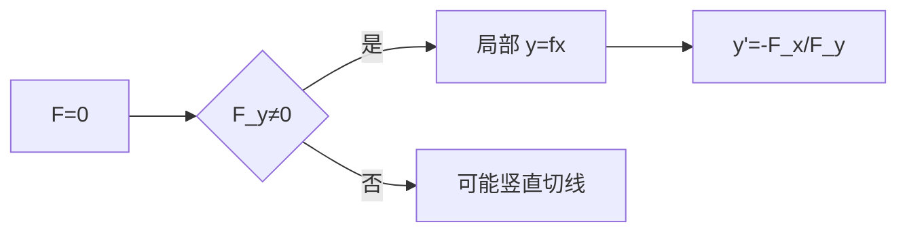

# 隐函数定理

- **难度**：高难 | **涉及章节**：第 18、23 章

## 一句话定义

方程 $F(x,y)=0$ 在某点附近能不能解出 $y=f(x)$，看对 $y$ 的偏导是否为零：不为零就能，且能求导。

## 为什么重要

它把"方程"变成"函数"，是曲线切线、曲面切平面、条件极值、反函数定理的共同基础。

## 图示

看图说明：一个判断点分出两条路。$F_y=0$ 不是"无解"，而是"不能解成 y 的函数"。

## 详解

三条件：$F$ 连续可微、$F(P_0)=0$、$F_y(P_0)\ne0$。结论：存在唯一连续可微的 $y=f(x)$，且 $f'=-F_x/F_y$。

隐函数组：$\frac{\partial(F,G)}{\partial(u,v)}\ne0$ 时存在 $u,v$ 作为 $x,y$ 的函数，偏导用克莱姆法则解。

反函数组：雅可比非零则可逆，逆的雅可比是原雅可比的逆矩阵。

几何应用：$F(x,y,z)=0$ 的切平面法向量是 $\nabla F$。

## 常见误解

- 以为条件只在一点检查就够全局。定理只给局部。
- 以为 $F_y=0$ 就无隐函数。可能反过来解出 $x=g(y)$。
- 以为隐函数求导要背公式。记住 $dF=0$ 更稳。

## 在书中出现的脉络

| 章节 | 语境 | 关键结论 |
|---|---|---|
| 18 | 隐函数存在定理 | $F_y\ne0$ |
| 18 | 隐函数组 | 雅可比非零 |
| 18 | 条件极值 | 拉格朗日乘数法 |
| 23 | 向量形式 | $J$ 可逆 |

## 相关概念

- 前置：全微分、雅可比
- 后续：反函数定理、条件极值
