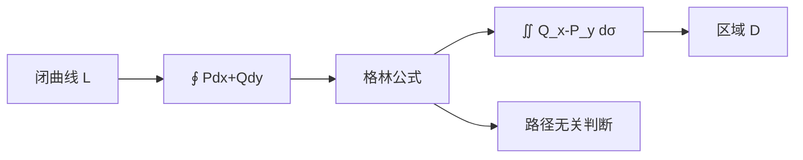

# 格林公式

- **难度**：高难 | **涉及章节**：第 20、21 章

## 一句话定义

沿闭曲线的第二型曲线积分，等于它围成的区域上"旋度"的二重积分。

## 为什么重要

它把一维边界上的信息与二维内部的密度联系起来。高斯公式、斯托克斯公式都是它在更高维的同款。路径无关判定也靠它。

## 图示

看图说明：左边是边界，右边是内部，公式是双向桥。方向必须正向（逆时针）。

## 详解

条件：$P,Q$ 在闭区域 $D$ 上有连续偏导，$L$ 是正向边界。

$$\oint_L P\,dx+Q\,dy=\iint_D(Q_x-P_y)\,d\sigma.$$

正向约定：沿 $L$ 行走时，$D$ 在左侧。外边界逆时针，内边界顺时针。

路径无关：在单连通区域上，$Q_x=P_y$ 时积分只与端点有关，存在势函数 $u$ 使 $du=Pdx+Qdy$，积分等于 $u$ 的端点差。

有洞的区域要小心：$\oint\frac{-y\,dx+x\,dy}{x^2+y^2}$ 绕原点一圈等于 $2\pi$，尽管 $Q_x-P_y=0$ 在除原点外处处成立，因为区域不是单连通。

## 常见误解

- 以为公式对任何闭曲线都成立。要求偏导连续且区域规则。
- 以为方向无所谓。方向反了结果变号。
- 以为 $Q_x=P_y$ 就一定有势函数。还需单连通。

## 在书中出现的脉络

| 章节 | 语境 | 关键结论 |
|---|---|---|
| 20 | 两类曲线积分 | 边界积分 |
| 21 | 格林公式 | 曲线与二重互化 |
| 21 | 路径无关 | 势函数存在 |
| 22 | 高斯与斯托克斯 | 高维推广 |

## 相关概念

- 前置：第二型曲线积分、二重积分
- 后续：高斯公式、斯托克斯公式、保守场
