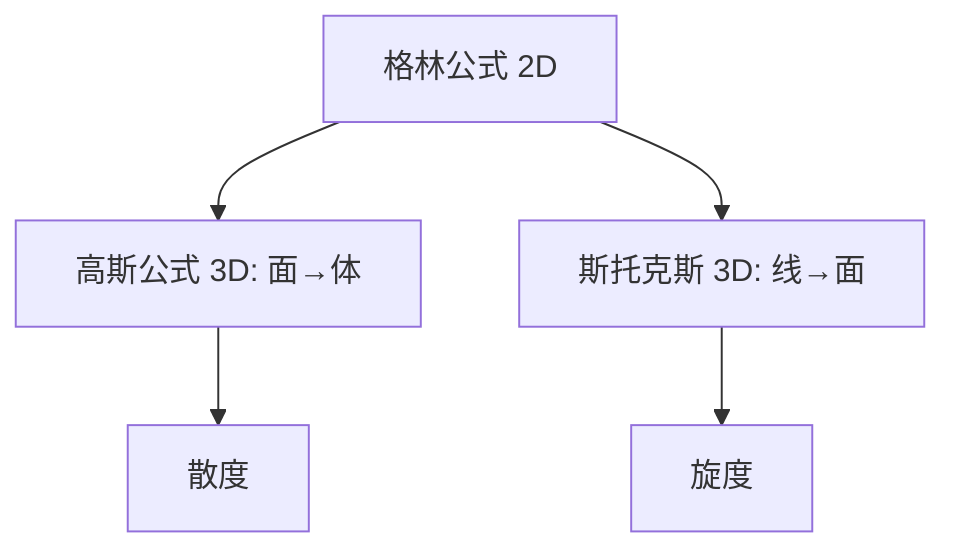

# 高斯公式与斯托克斯公式

- **难度**：高难 | **涉及章节**：第 22 章

## 一句话定义

高斯公式：闭曲面的通量等于体内散度的三重积分。斯托克斯公式：空间闭曲线的环量等于曲面上旋度的积分。

## 为什么重要

它们是格林公式的升维版本，把"边界上的积分"统一成"内部导数的积分"。场论的散度、旋度就靠这两条定义物理含义。

## 图示

看图说明：格林是二维母版，往上升出两条。D、E 分别是两个公式右边的核心量。

## 详解

高斯：$\oiint_\Sigma P\,dydz+Q\,dzdx+R\,dxdy=\iiint_\Omega(P_x+Q_y+R_z)dV$，$\Sigma$ 取外侧。

斯托克斯：$\oint_\Gamma P\,dx+Q\,dy+R\,dz=\iint_\Sigma(\nabla\times\mathbf F)\cdot\mathbf n\,dS$，方向按右手系。

用法：曲面不闭合时补面，曲线不闭合时补线，算完减去补的部分。

散度：$\nabla\cdot\mathbf F$，正为源、负为汇、零为无源场。旋度：$\nabla\times\mathbf F$，描述局部旋转。

恒等式 $\nabla\cdot(\nabla\times\mathbf F)=0$ 说明"旋度场无源"，这是电磁学里磁场无散度的数学表达。

## 常见误解

- 以为高斯公式对开曲面直接可用。必须先闭合。
- 以为斯托克斯的方向可以任选。右手系定则不能违反。
- 以为散度是向量。散度是标量，旋度才是向量。

## 在书中出现的脉络

| 章节 | 语境 | 关键结论 |
|---|---|---|
| 22 | 高斯公式 | 通量与散度 |
| 22 | 斯托克斯 | 环量与旋度 |
| 22 | 场论 | 管量场、势函数 |

## 相关概念

- 前置：第二型曲面积分、格林公式
- 后续：场论、麦克斯韦方程
